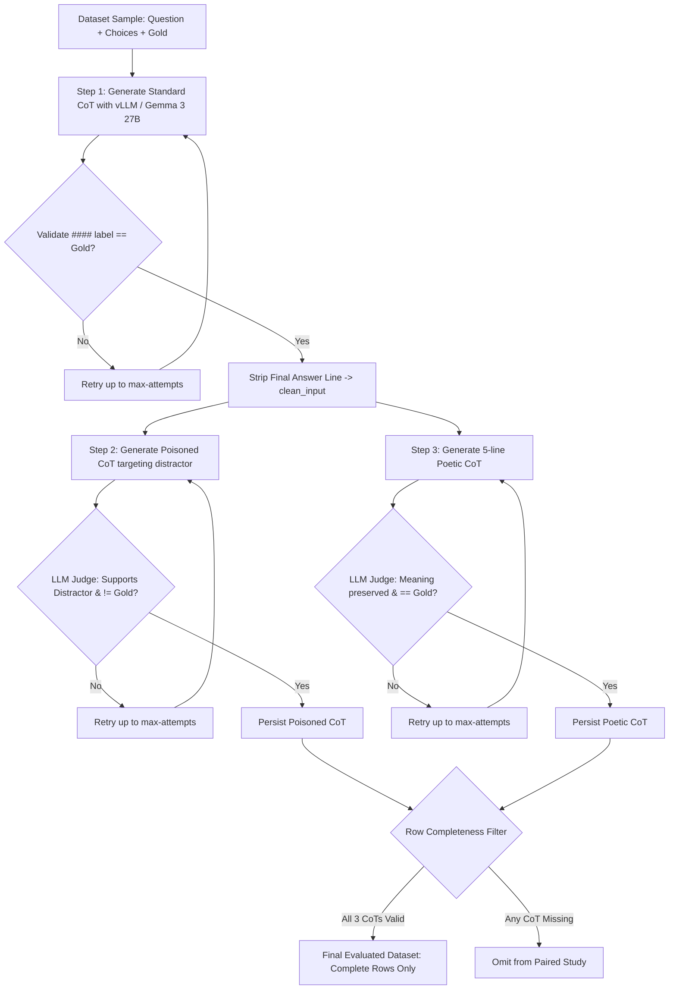

# Stylistic Distillation and Decision Model Conditioning via Poetic Chain-of-Thought

A research and evaluation platform investigating the causal interaction between **generative reasoning rationales** and **discriminative System-One decision models**.

---

## Table of Contents

- [Executive Summary](#executive-summary)
- [Research Questions & Hypotheses](#research-questions--hypotheses)
- [Key Findings Snapshot](#key-findings-snapshot)
- [Evaluation Framework: The 4 Isolated Conditions](#evaluation-framework-the-4-isolated-conditions)
- [Benchmarks & Datasets](#benchmarks--datasets)
- [CoT Generation & LLM-as-a-Judge Pipeline](#cot-generation--llm-as-a-judge-pipeline)
- [Decision Model Architectures & Strict Split Isolation](#decision-model-architectures--strict-split-isolation)
- [Statistical Methodology & Metrics](#statistical-methodology--metrics)
- [Empirical Results](#empirical-results)
  - [1. AI2 ARC-Easy](#1-ai2-arc-easy-2095-shared-examples)
  - [2. LogiQA Formal Deductive Logic](#2-logiqa-formal-deductive-logic-590-shared-examples)
  - [3. TypedDecisions Operational Tasks](#3-typeddecisions-operational-tasks-977-shared-examples)
- [Installation & Environment Setup](#installation--environment-setup)
- [Step-by-Step Reproduction Guide & CLI Examples](#step-by-step-reproduction-guide--cli-examples)
  - [Step 1: Multi-Condition CoT Generation (vLLM / Gemini)](#step-1-multi-condition-cot-generation-vllm--gemini)
  - [Step 2: Decision Model Fine-Tuning](#step-2-decision-model-fine-tuning)
  - [Step 3: Launching Decision Model Serving Runtimes](#step-3-launching-decision-model-serving-runtimes)
  - [Step 4: Running 4-Condition CoT Evaluations](#step-4-running-4-condition-cot-evaluations)
  - [Step 5: Aggregating & Visualizing Evaluation Results](#step-5-aggregating--visualizing-evaluation-results)
  - [Legacy Gemini CLI Workflow](#legacy-gemini-cli-workflow)
- [Output Artifacts & File Schemas](#output-artifacts--file-schemas)
- [Codebase Architecture & Directory Layout](#codebase-architecture--directory-layout)
- [Running Unit Tests](#running-unit-tests)

---

## Executive Summary

Standard Chain-of-Thought (CoT) prompting has dramatically improved language model problem-solving. However, standard rationales generated by autoregressive LLMs (e.g., Gemma 3 27B, Gemini) are verbose, conversational, and token-heavy. Furthermore, in conventional setups, generation and final decision-making are coupled within a single autoregressive pass, leaving open whether external discriminative decision systems can genuinely interpret and benefit from reasoning.

This project investigates two core questions by **decoupling rationale generation from categorical decision-making**:

1. **Research Question 1 (RQ1 — Compression & Efficiency)**: *Can a strictly constrained, 5-line Poetic Chain-of-Thought distill reasoning to its essential semantic skeleton, matching Standard CoT accuracy while slashing token overhead?*
2. **Research Question 2 (RQ2 — Reasoning Utilization & Causal Reliance)**: *Do specialized "System-One" discriminative decision models genuinely attend to the logical validity of external reasoning paths, or do they merely benefit from superficial prompt length and keyword overlap?*

```
┌─────────────────────────────────┐                       ┌─────────────────────────────────┐
│     Generative Reasoner         │                       │   Discriminative Decision Model │
│   (Gemma 3 27B / Gemini API)    │                       │         (System-One)            │
├─────────────────────────────────┤   Filtered Rationale  ├─────────────────────────────────┤
│ • Standard CoT (Step-by-step)   │ ────────────────────> │ • Laya (ModernBERT, ~322M)      │ ───> Choice
│ • Poetic CoT (5-line verse)     │  (Answer Stripped)    │ • Kev (Qwen 3.5 4B + LoRA)      │      Decision
│ • Poisoned CoT (Adversarial)    │                       │ • JEV (Cloud System-One API)    │      (✓ / ✗)
└─────────────────────────────────┘                       └─────────────────────────────────┘
```

---

## Research Questions & Hypotheses

### RQ1: Poetic CoT vs. Standard CoT (Accuracy vs. Token Footprint)
* **The Information Compression Hypothesis**: Verbose CoT contains conversational padding, hedging, and redundant reformulations. Constraining reasoning into a strict 5-line poetic verse (inspired by Tanka/Limerick structures) forces the generator to capture only the essential logical predicates.
* **Token Efficiency Metric**:
  $$\Delta \%_{\text{tokens}} = \frac{\bar{T}_{\text{condition}} - \bar{T}_{\text{question\_only}}}{\bar{T}_{\text{question\_only}}} \times 100$$
* **Stylistic Invariance**: If decision models maintain high choice accuracy when conditioned on metaphorical, rhythmic verse that strictly omits literal answer keys, they demonstrate conceptual reasoning rather than verbatim template matching.

### RQ2: Decision Model Reasoning Utilization & Adversarial Poisoning
* **Generative-to-Discriminative Bridging**: We feed generated rationales into dedicated classification and pointer-network decision models.
* **The Adversarial Poisoning Check**: To rule out *spurious correlation* (e.g. models improving merely because inputs are longer), we construct an adversarial condition (`poisoned_reasoning`). If the model genuinely follows the reasoning path, a subtly corrupted explanation arguing for a distractor must trigger an immediate, catastrophic performance drop.

---

## Key Findings Snapshot

```text
  Accuracy Gain over Baseline (LogiQA / Kev-FT)
  Standard CoT: ████████████████████ +37.97 pp (Requires +352 tokens)
  Poetic CoT:   ███████████████       +27.97 pp (Requires ONLY +68 tokens)
  --> Poetic captures 74% of accuracy gain with an 80% reduction in rationale tokens!

  Accuracy Gain over Baseline (LogiQA / Laya-FT)
  Standard CoT: █████                 +6.27 pp
  Poetic CoT:   ████████              +10.68 pp  <-- POETIC WINS!
  --> Strict poetic compression filters out misleading noise for smaller models!
```

1. **Extreme Token Efficiency**: Across all datasets, Poetic CoT added only **+47 to +68 tokens** per question compared to Standard CoT's **+93 to +352 tokens** (an **up to 80% reduction in rationale footprint**).
2. **Comparable (and Superior) Accuracy**: Poetic CoT achieves **80% to 105%** of the accuracy gains of Standard CoT. On LogiQA with Laya-FT, **Poetic CoT substantially outperformed Standard CoT (+10.68 pp vs. +6.27 pp)**, proving that poetic compression acts as an inductive regularizer that filters distracting noise for smaller models.
3. **Causal Sensitivity Proved by Adversarial Poisoning**: Decision models do not ignore rationales. When given poisoned reasoning, performance collapses catastrophically:
   - **Kev** drops by **−62.72 pp** on ARC, **−53.73 pp** on LogiQA, and **−47.70 pp** on TypedDecisions.
   - All 95% bootstrap confidence intervals for poisoned reasoning exclude zero by wide margins.

---

## Evaluation Framework: The 4 Isolated Conditions

Every benchmark sample is evaluated across **four strictly isolated conditions**:

| # | Condition Name | Input Provided to Decision Model | Purpose & Safeguards |
|---|---|---|---|
| 1 | `question_only` | `Question` + `Choices` | **Baseline**: Evaluates the decision model's innate zero-shot or fine-tuned capability without reasoning aids. |
| 2 | `standard_reasoning` | `Question` + `Choices` + `Standard CoT` | **Benchmark Augmentation**: Step-by-step factual reasoning. **Critical safeguard**: The trailing final-answer line (`The final answer is #### <label>`) is automatically stripped before inference so the model cannot exploit label leaks. |
| 3 | `poisoned_reasoning` | `Question` + `Choices` + `Poisoned CoT` | **Adversarial Control**: Factual or logical error introduced to lead toward a specific non-gold distractor choice. Proves whether the model genuinely attends to reasoning semantics. |
| 4 | `poetic_reasoning` | `Question` + `Choices` + `Poetic CoT` | **Distilled Reasoning**: Scientifically accurate 5-line poem encoding the deduction without revealing option labels or verbatim target choice text. |

---

## Benchmarks & Datasets

Three diverse benchmark datasets representing distinct cognitive reasoning regimes are supported, mapped into a canonical `ArcRecord` schema:

1. **AI2 ARC (Science QA)** (`allenai/ai2_arc`):
   - ARC-Easy and ARC-Challenge splits.
   - Grade-school scientific reasoning and physical commonsense questions with 4 choices.
2. **TypedDecisions (Operational & Enterprise Decisions)** (`LocalLLaMA/typed-decisions`):
   - Structured enterprise operational tasks: customer service routing, invoice anomaly detection, security incident response, and agent trace debugging.
   - Hierarchical state telemetry mapped into question context paired with operational action pathways.
3. **LogiQA (Formal Logic & Deductive Reasoning)** (`lucasmccabe/logiqa`):
   - Translated from the Chinese National Civil Service Examination.
   - Syllogisms, conditional logic, contrapositives, and mutual exclusivity over multi-sentence analytical reading passages.
4. **ProofWriter (Logical Theories)** (`proofwriter`):
   - Multi-hop rule-based deduction over formal theories.

---

## CoT Generation & LLM-as-a-Judge Pipeline

Generating high-fidelity reasoning across three distinct modalities while preventing label leaks requires a multi-stage generate-and-judge pipeline (`scripts/generate_arc_cot_vllm.py`):



### Generation & Verification Contracts
1. **Standard CoT**: Prompted to generate a factual explanation concluding with `The final answer is ####<label>`. Validated against ground truth `answerKey`. The final answer line is **stripped** to yield `clean_input`.
2. **Poisoned CoT**: Deterministically selects a non-gold target distractor via modular index:
   $$\text{target} = \text{distractors}[i \pmod{|\text{distractors}|}]$$
   The LLM rewrites `clean_input` with exactly one plausible, deceptive logical or factual flaw leading to the target distractor. The LLM Judge verifies that the distractor is supported and $\neq \text{gold}$.
3. **Poetic CoT**: Rewrites `clean_input` into a 5-line poem preserving essential causality without mentioning option labels or verbatim answer text. The LLM Judge must independently identify the gold answer solely from the poem.
4. **Complete Rows Filter**: Only samples where all 3 variants pass validation are kept, preventing survivorship bias in downstream comparisons.

---

## Decision Model Architectures & Strict Split Isolation

### Evaluated Architectures
1. **Laya** (`convaiinnovations/laya`):
   - ModernBERT base architecture (~322M parameters).
   - Evaluates choices directly in-process via PyTorch on CUDA; scores criteria using an internal routing head.
2. **Kev** (`jaredpalmer/kev-4b`):
   - Backbone: `Qwen/Qwen3.5-4B-Base` with LoRA adapters ($r=64, \alpha=128$) and pointer-network classification heads.
   - High-throughput local HTTP server implementing the `/v1/systemone` specification in `bfloat16`.
3. **JEV** (`jev-latest`):
   - Hosted cloud enterprise decision engine by TypeSafe AI serving `/v1/systemone` over HTTPS.
4. **Clef** (`Cloudflare/clef-flash` / `Cloudflare/clef`):
   - 9B or 27B model served via an SGLang Docker container exposing `/v1/systemone`.

### Strict Split Isolation Guarantee
To prevent data contamination and ensure genuine out-of-distribution reasoning absorption:
- **Train Split Only**: All decision model fine-tuning was performed strictly on the official `train` split of each benchmark against gold choices.
- **Zero Contamination**: **Models were fine-tuned WITHOUT CoT reasoning in their training data.** They were trained to predict choices from question context alone. Any downstream CoT benefit observed during evaluation arises strictly from zero-shot reasoning absorption.
- **Validation Monitoring**: 10% seeded holdout from `train` used for checkpoint selection. The `test` split was held out untouched until final inference.

#### Native Training Formats

**Laya Native Format (`train.jsonl`)**:
```json
{
  "state": {"question": "Which trait is passed from parent to offspring?"},
  "questions": {
    "arc_answer": {
      "type": "choice",
      "instructions": "Select the correct answer from the choices provided.",
      "criteria": {"A": "learned language", "B": "eye color", "C": "broken bone"}
    }
  },
  "expected": {"arc_answer": "B"}
}
```

**Kev Native Format (`train.jsonl`)**:
```json
{
  "state": {"question": "Which trait is passed from parent to offspring?"},
  "questions": {
    "arc_answer": {
      "type": "choice",
      "instructions": "Select the correct answer from the choices provided.",
      "criteria": {"A": "learned language", "B": "eye color", "C": "broken bone"},
      "label": "B"
    }
  }
}
```

---

## Statistical Methodology & Metrics

All comparative evaluations are conducted on the **shared completion cohort** (the subset where all 4 conditions successfully returned a decision).

1. **Paired Percentage Point Difference ($\Delta pp$)**:
   For condition $C \in \{\text{standard}, \text{poisoned}, \text{poetic}\}$ relative to baseline $B = \text{question\_only}$:
   $$d_i = \mathbb{I}(y_i^{(C)} = y_i^*) - \mathbb{I}(y_i^{(B)} = y_i^*)$$
   $$\Delta pp = \left( \frac{1}{N} \sum_{i=1}^N d_i \right) \times 100$$
2. **2,000 Paired Bootstrap Resamples (95% CI)**:
   Non-parametric bootstrap with fixed seed ($7$). 95% Confidence Intervals $[CI_{\text{low}}, CI_{\text{high}}]$ are drawn from the 2.5th and 97.5th percentiles. Statistical significance ($\alpha = 0.05$) requires the interval to exclude zero.
3. **Rationale Token Overhead ($\Delta \%_{\text{tokens}}$)**:
   Calculated from model-reported input tokens against baseline `question_only`.

---

## Empirical Results

### 1. AI2 ARC-Easy (2,095 Shared Examples)

| Decision Model | Condition | Accuracy | $\Delta pp$ vs. Baseline | 95% Bootstrap CI | Mean Input Tokens | Rationale $\Delta \%_{\text{tokens}}$ |
|---|---|---|---|---|---|---|
| **Kev (Fine-Tuned)** | `question_only` | 98.33% | *Baseline* | — | 135.4 | 0.0% |
| | `standard_reasoning` | **100.00%** | **+1.67 pp** | [+1.15, +2.24] | 228.6 | +68.8% (+93.2 tok) |
| | `poetic_reasoning` | **99.71%** | **+1.38 pp** | [+0.86, +1.96] | 182.4 | **+34.7% (+47.0 tok)** |
| | `poisoned_reasoning`| 35.61% | **-62.72 pp** | [-64.87, -60.48] | 279.3 | +106.2% |
| **Laya (Fine-Tuned)**| `question_only` | 37.90% | *Baseline* | — | 145.9 | 0.0% |
| | `standard_reasoning` | **71.79%** | **+33.89 pp** | [+31.69, +36.09] | 243.1 | +66.6% (+97.2 tok) |
| | `poetic_reasoning` | **59.81%** | **+21.91 pp** | [+19.81, +24.20] | 198.1 | **+35.8% (+52.2 tok)** |
| | `poisoned_reasoning`| 30.60% | **-7.30 pp** | [-9.40, -5.16] | 294.6 | +101.9% |
| **JEV (Cloud)** | `question_only` | 99.86% | *Baseline* | — | — | — |
| | `standard_reasoning` | 99.95% | +0.10 pp | [-0.10, +0.29] | — | — |
| | `poetic_reasoning` | 99.90% | +0.05 pp | [-0.10, +0.19] | — | — |
| | `poisoned_reasoning`| 96.95% | **-2.91 pp** | [-3.68, -2.20] | — | — |

---

### 2. LogiQA Formal Deductive Logic (590 Shared Examples)

| Decision Model | Condition | Accuracy | $\Delta pp$ vs. Baseline | 95% Bootstrap CI | Mean Input Tokens | Rationale $\Delta \%_{\text{tokens}}$ |
|---|---|---|---|---|---|---|
| **Kev (Fine-Tuned)** | `question_only` | 61.36% | *Baseline* | — | 334.7 | 0.0% |
| | `standard_reasoning` | **99.32%** | **+37.97 pp** | [+34.07, +42.03] | 687.0 | +105.2% (+352.3 tok) |
| | `poetic_reasoning` | **89.32%** | **+27.97 pp** | [+24.07, +31.69] | 403.2 | **+20.5% (+68.5 tok)** |
| | `poisoned_reasoning`| 7.63% | **-53.73 pp** | [-57.63, -49.49] | 698.6 | +108.7% |
| **Laya (Fine-Tuned)**| `question_only` | 28.98% | *Baseline* | — | 339.6 | 0.0% |
| | `standard_reasoning` | 35.25% | +6.27 pp | [+2.71, +9.83] | 510.5 | +50.3% (+170.9 tok) |
| | `poetic_reasoning` | **39.66%** | **+10.68 pp** | [+6.61, +14.58] | 407.3 | **+19.9% (+67.7 tok)** |
| | `poisoned_reasoning`| 22.88% | **-6.10 pp** | [-9.66, -2.54] | 510.5 | +50.3% |
| **JEV (Cloud)** | `question_only` | 74.65% | *Baseline* | — | — | — |
| | `standard_reasoning` | **97.20%** | **+20.17 pp** | [+17.12, +23.39] | — | — |
| | `poetic_reasoning` | **94.24%** | **+16.27 pp** | [+13.22, +19.32] | — | — |
| | `poisoned_reasoning`| 63.16% | **-13.73 pp** | [-16.95, -10.51] | — | — |

> **Highlight**: On LogiQA with Laya, **Poetic CoT (+10.68 pp) substantially outperforms Standard CoT (+6.27 pp)** while consuming only 67.7 tokens versus 170.9 tokens.

---

### 3. TypedDecisions Operational Tasks (977 Shared Examples)

| Decision Model | Condition | Accuracy | $\Delta pp$ vs. Baseline | 95% Bootstrap CI | Mean Input Tokens | Rationale $\Delta \%_{\text{tokens}}$ |
|---|---|---|---|---|---|---|
| **Kev (Fine-Tuned)** | `question_only` | 87.00% | *Baseline* | — | 384.7 | 0.0% |
| | `standard_reasoning` | **96.01%** | **+9.01 pp** | [+7.06, +10.85] | 468.0 | +21.7% (+83.3 tok) |
| | `poetic_reasoning` | **93.65%** | **+6.65 pp** | [+5.02, +8.29] | 433.6 | **+12.7% (+49.0 tok)** |
| | `poisoned_reasoning`| 39.30% | **-47.70 pp** | [-51.07, -44.32] | 517.5 | +34.5% |
| **Laya (Fine-Tuned)**| `question_only` | 51.33% | *Baseline* | — | — | 0.0% |
| | `standard_reasoning` | **66.06%** | **+13.51 pp** | [+11.05, +16.27] | — | — |
| | `poetic_reasoning` | **59.26%** | **+5.42 pp** | [+3.07, +7.98] | — | — |
| | `poisoned_reasoning`| 39.91% | **-11.87 pp** | [-14.84, -8.70] | — | — |
| **JEV (Cloud)** | `question_only` | 72.83% | *Baseline* | — | — | — |
| | `standard_reasoning` | **96.42%** | **+21.39 pp** | [+18.83, +23.95] | — | — |
| | `poetic_reasoning` | **94.26%** | **+17.71 pp** | [+15.35, +20.16] | — | — |
| | `poisoned_reasoning`| 65.09% | **-10.85 pp** | [-13.41, -8.39] | — | — |

---

## Installation & Environment Setup

### 1. Environment Installation

```bash
cd /home/gpuuser7/gpuuser7_a/Divyanshu/GSM8K/arc_decision_reasoning

# Install package in editable mode with vLLM and Laya support
/home/gpuuser7/gpuuser7_a/Divyanshu/GSM8K/.venv/bin/python -m pip install -e '.[laya,vllm]'

# If evaluating or fine-tuning Clef:
/home/gpuuser7/gpuuser7_a/Divyanshu/GSM8K/.venv/bin/python -m pip install clef-finetune
```

### 2. Configure Environment Variables (`.env`)

Copy `.env.example` to `.env` and configure credentials:

```bash
cp .env.example .env
```

Key environment settings in `.env`:
```ini
# CUDA & GPU Selection
CUDA_VISIBLE_DEVICES=0
LAYA_DEVICE=cuda

# Kev Local Server Settings
KEV_MODEL_ID=/home/gpuuser7/gpuuser7_a/Divyanshu/GSM8K/arc_decision_reasoning/outputs/finetunes/kev_typed_decisions_all/checkpoint
KEV_API_URL=http://127.0.0.1:8008/v1/systemone
KEV_DTYPE=bf16

# Hosted JEV Cloud Settings
JEV_API_KEY=your_typesafe_jev_api_key_here
JEV_API_URL=https://api.typesafe.ai/v1/systemone
JEV_MODEL_ID=jev-latest

# Gemini Generation API Keys (used if running Gemini backend)
GEMINI_API_KEY_1=your_gemini_key_1
GEMINI_API_KEY_2=your_gemini_key_2
```

### 3. The CUDA Wrapper (`run_cuda.sh`)
Always execute Python commands via `run_cuda.sh`. It injects CUDA library paths into `LD_LIBRARY_PATH`, sets `LAYA_DEVICE=cuda`, sources `.env`, and sets `PYTHONPATH=src`.

```bash
bash ./run_cuda.sh <python_command_or_script>
```

---

## Step-by-Step Reproduction Guide & CLI Examples

Follow this end-to-end pipeline to replicate any experimental cohort from scratch.

### Step 1: Multi-Condition CoT Generation (vLLM / Gemini)

Use `scripts/generate_arc_cot_vllm.py` to generate standard, poisoned, and poetic CoT rationales. The script automatically checkpoints every batch and persists a tracking report.

#### 1. Generate ARC-Easy Test CoTs
```bash
bash ./run_cuda.sh scripts/generate_arc_cot_vllm.py \
  --backend vllm \
  --model google/gemma-3-27b-it \
  --dataset arc \
  --type easy \
  --split test \
  --batch-size 12 \
  --gpu-memory-utilization 0.90 \
  --output-dir outputs/vllm_cot
```

#### 2. Generate LogiQA Deductive CoTs
```bash
bash ./run_cuda.sh scripts/generate_arc_cot_vllm.py \
  --backend vllm \
  --model google/gemma-3-27b-it \
  --dataset logiqa \
  --split test \
  --batch-size 12 \
  --output-dir outputs/vllm_cot
```

#### 3. Generate TypedDecisions Operational CoTs
```bash
bash ./run_cuda.sh scripts/generate_arc_cot_vllm.py \
  --backend vllm \
  --model google/gemma-3-27b-it \
  --dataset typed_decisions \
  --split test \
  --batch-size 12 \
  --output-dir outputs/vllm_cot
```

> **Resume Interrupted Runs**: If generation is paused, pass `--resume` to fill in blank CoT cells without regenerating completed ones. Use `--force` to recompute all columns.

---

### Step 2: Decision Model Fine-Tuning

Decision models are fine-tuned strictly on the `train` split against gold labels without CoT rationales.

#### 1. Fine-Tuning Kev on Datasets (Qwen 3.5 4B Backbone + LoRA)
```bash
# Fine-tune Kev on TypedDecisions:
bash ./run_cuda.sh scripts/finetune_kev.py \
  --dataset typed_decisions \
  --dataset-config all \
  --replace \
  --output-dir outputs/finetunes/kev_typed_decisions_all

# Fine-tune Kev on LogiQA:
bash ./run_cuda.sh scripts/finetune_kev.py \
  --dataset logiqa \
  --dataset-config default \
  --replace \
  --output-dir outputs/finetunes/kev_logiqa_default

# Fine-tune Kev on ARC-Easy:
bash ./run_cuda.sh scripts/finetune_kev.py \
  --dataset arc \
  --difficulty easy \
  --replace \
  --output-dir outputs/finetunes/kev_arc_easy
```

#### 2. Fine-Tuning Laya on Datasets (ModernBERT In-Process)
```bash
# Fine-tune Laya on TypedDecisions:
bash ./run_cuda.sh scripts/finetune_laya.py \
  --dataset typed_decisions \
  --dataset-config all \
  --replace \
  --output-dir outputs/finetunes/laya_typed_decisions_all

# Fine-tune Laya on LogiQA:
bash ./run_cuda.sh scripts/finetune_laya.py \
  --dataset logiqa \
  --dataset-config default \
  --replace \
  --output-dir outputs/finetunes/laya_logiqa_default

# Fine-tune Laya on ARC-Easy:
bash ./run_cuda.sh scripts/finetune_laya.py \
  --dataset arc \
  --difficulty easy \
  --replace \
  --output-dir outputs/finetunes/laya_arc_easy
```

#### 3. Inspecting / Preparing Native Training Data Only
To generate `train.jsonl` and `validation.jsonl` without launching training:
```bash
bash ./run_cuda.sh scripts/finetune_decision_model.py \
  --model kev \
  --dataset typed_decisions \
  --prepare-only
```

---

### Step 3: Launching Decision Model Serving Runtimes

#### Launching Local Kev Server (Port 8008)
To evaluate Kev checkpoints, launch the server pointing to the target checkpoint:
```bash
# In a dedicated terminal or tmux session:
cd /home/gpuuser7/gpuuser7_a/Divyanshu/GSM8K/arc_decision_reasoning
bash ./run_kev_server.sh outputs/finetunes/kev_typed_decisions_all/checkpoint
```

#### Launching Clef SGLang Server (Port 30000)
```bash
bash ./run_clef_server.sh
```

#### Laya (No Server Needed)
Laya runs directly in-process via PyTorch CUDA. Simply pass `--laya-finetuned-checkpoint` to the evaluation script.

#### JEV (Cloud API)
Set `JEV_API_KEY` in `.env`. No local server is required.

---

### Step 4: Running 4-Condition CoT Evaluations

Use `scripts/evaluate_cot_decision_model.py` to evaluate across `question_only`, `standard_reasoning`, `poisoned_reasoning`, and `poetic_reasoning`.

#### 1. Evaluating Kev (Fine-Tuned)
```bash
# ARC-Easy:
bash ./run_cuda.sh scripts/evaluate_cot_decision_model.py \
  --input-csv outputs/vllm_cot_easy_test_full/ARC_easy_test_complete_rows.csv \
  --decision-model kev \
  --kev-finetuned-checkpoint outputs/finetunes/kev_arc_easy/checkpoint \
  --output-dir outputs/cot_evaluations/arc_easy_kev_ft

# LogiQA:
bash ./run_cuda.sh scripts/evaluate_cot_decision_model.py \
  --input-csv outputs/vllm_cot/LogiQA_default_test.csv \
  --decision-model kev \
  --kev-finetuned-checkpoint outputs/finetunes/kev_logiqa_default/checkpoint \
  --output-dir outputs/cot_evaluations/logiqa_kev_ft

# TypedDecisions:
bash ./run_cuda.sh scripts/evaluate_cot_decision_model.py \
  --input-csv outputs/vllm_cot/TypedDecisions_all_test.csv \
  --decision-model kev \
  --kev-finetuned-checkpoint outputs/finetunes/kev_typed_decisions_all/checkpoint \
  --output-dir outputs/cot_evaluations/typed_decisions_kev_ft
```

#### 2. Evaluating Laya (In-Process PyTorch)
```bash
# ARC-Easy:
bash ./run_cuda.sh scripts/evaluate_cot_decision_model.py \
  --input-csv outputs/vllm_cot_easy_test_full/ARC_easy_test_complete_rows.csv \
  --decision-model laya \
  --laya-finetuned-checkpoint outputs/finetunes/laya_arc_easy/checkpoint \
  --output-dir outputs/cot_evaluations/arc_easy_laya_ft

# LogiQA:
bash ./run_cuda.sh scripts/evaluate_cot_decision_model.py \
  --input-csv outputs/vllm_cot/LogiQA_default_test.csv \
  --decision-model laya \
  --laya-finetuned-checkpoint outputs/finetunes/laya_logiqa_default/checkpoint \
  --output-dir outputs/cot_evaluations/logiqa_laya_ft

# TypedDecisions:
bash ./run_cuda.sh scripts/evaluate_cot_decision_model.py \
  --input-csv outputs/vllm_cot/TypedDecisions_all_test.csv \
  --decision-model laya \
  --laya-finetuned-checkpoint outputs/finetunes/laya_typed_decisions_all/checkpoint \
  --output-dir outputs/cot_evaluations/typed_decisions_laya_ft
```

#### 3. Evaluating Hosted JEV (Cloud System-One API)
```bash
# LogiQA:
bash ./run_cuda.sh scripts/evaluate_cot_decision_model.py \
  --input-csv outputs/vllm_cot/LogiQA_default_test.csv \
  --decision-model jev \
  --concurrency 4 \
  --output-dir outputs/cot_evaluations/logiqa_jev

# TypedDecisions:
bash ./run_cuda.sh scripts/evaluate_cot_decision_model.py \
  --input-csv outputs/vllm_cot/TypedDecisions_all_test.csv \
  --decision-model jev \
  --concurrency 4 \
  --output-dir outputs/cot_evaluations/typed_decisions_jev
```

---

### Step 5: Aggregating & Visualizing Evaluation Results

Use `scripts/combine_cot_summaries.py` to aggregate per-run results into unified comparison matrices and multi-dataset master summaries:

```bash
# Auto-discover all datasets and build master tables:
/home/gpuuser7/gpuuser7_a/Divyanshu/GSM8K/.venv/bin/python scripts/combine_cot_summaries.py

# Combine only LogiQA runs:
/home/gpuuser7/gpuuser7_a/Divyanshu/GSM8K/.venv/bin/python scripts/combine_cot_summaries.py --dataset logiqa
```

This outputs unified CSVs under `outputs/cot_evaluations/combined_summaries/`:
- `all_datasets_summary.csv` — master table across all benchmarks and models
- `<dataset>_comparison_matrix.csv` — cross-model condition-by-condition comparison matrix
- `<dataset>_token_latency_summary.csv` — token overhead and latency comparisons

---

### Legacy Gemini CLI Workflow

For legacy experiments directly pairing Gemini-generated rationales with the ARC benchmark:

```bash
# Run full smoke pipeline on ARC-Easy (5 samples):
bash ./run_cuda.sh -m arc_decision.cli run \
  --dataset-config easy \
  --split test \
  --limit 5 \
  --gemini-model gemini-2.5-flash \
  --decision-model laya \
  --poem-form tanka \
  --output-dir outputs/arc_easy_laya_smoke

# Staged CLI commands:
bash ./run_cuda.sh -m arc_decision.cli prepare --dataset-config easy --split test --output-dir outputs/arc_run
bash ./run_cuda.sh -m arc_decision.cli generate --output-dir outputs/arc_run --resume
bash ./run_cuda.sh -m arc_decision.cli evaluate --decision-model laya --output-dir outputs/arc_run --resume
bash ./run_cuda.sh -m arc_decision.cli analyze --output-dir outputs/arc_run
```

---

## Output Artifacts & File Schemas

Each evaluation run directory under `outputs/cot_evaluations/<run_name>/` produces standardized, reproducible artifacts:

| File | Content & Schema |
|---|---|
| `summary.csv` | Condition-level metrics: eligible examples, completed predictions, coverage, accuracy, shared-completion accuracy, paired bootstrap $\Delta pp$ and 95% CIs vs. baseline, mean CoT tokens, and token overhead percentage. |
| `decision_predictions.csv` | Per-question, per-condition predictions containing question stem, selected choice label, correctness indicator, raw model confidence scores, and token usage counts. |
| `token_latency_summary.csv` | Detailed latency distribution (p50, p90, p99) and input/output token usage per condition. |
| `per_question_comparison.csv` | Wide-format tabular view comparing decisions for each question across all 4 conditions side-by-side. |
| `analysis/paired_comparisons.json` | Statistical test ledgers recording the exact 2,000 bootstrap resample distributions and p-values for all pairwise condition differences. |
| `errors.csv` | Network timeouts, schema validation failures, or runtime retries logged with timestamps. |

---

## Codebase Architecture & Directory Layout

```text
arc_decision_reasoning/
├── .env                                # Local environment settings (CUDA, server endpoints, API keys)
├── .env.example                        # Template for environment configuration
├── run_cuda.sh                         # Master CUDA & PYTHONPATH wrapper script
├── run_kev_server.sh                   # Script to serve Kev checkpoint via local HTTP (port 8008)
├── run_clef_server.sh                  # Script to launch Clef SGLang Docker container (port 30000)
├── pyproject.toml                      # Package specifications, dependencies, and entrypoints
├── configs/
│   └── experiment.yaml                 # Default evaluation configs and pacing limits
├── scripts/
│   ├── generate_arc_cot_vllm.py        # Generates standard, poisoned, and poetic CoT with vLLM
│   ├── finetune_decision_model.py      # Unified CLI entrypoint for decision model fine-tuning
│   ├── finetune_laya.py                # Specialized launcher for Laya CLI training
│   ├── finetune_kev.py                 # Specialized launcher for Kev CLI training
│   ├── finetune_clef.py                # Specialized launcher for Clef CLI training
│   ├── evaluate_cot_decision_model.py  # Master 4-condition CoT evaluation pipeline
│   └── combine_cot_summaries.py        # Aggregator combining summaries across models and datasets
├── src/arc_decision/
│   ├── dataset.py                      # Dataset loaders for ARC, TypedDecisions, LogiQA, ProofWriter
│   ├── vllm_cot.py                     # vLLM generation routines, prompt formats, and judge validators
│   ├── decision_client.py              # Decision client adapters (Laya, Kev, JEV, Clef)
│   ├── cot_evaluation.py               # 4-condition orchestration, resume ledgers, and token accounting
│   ├── finetuning.py                   # Data formatting (train.jsonl) and native training subprocesses
│   ├── metrics.py                      # Paired bootstrap CI and token difference computation
│   ├── analysis.py                     # Analysis projections (summary.csv, paired_comparisons.json)
│   └── cli.py                          # Legacy ARC Gemini execution CLI
├── tests/                              # Comprehensive offline unit test suite (86 tests)
└── outputs/
    ├── vllm_cot/                       # Complete CoT CSVs with verified standard, poisoned, and poetic CoT
    ├── finetunes/                      # Checkpoints: laya_arc_easy, kev_typed_decisions_all, kev_logiqa_default...
    └── cot_evaluations/                # Evaluation runs and aggregated summary files
        └── combined_summaries/         # Master cross-benchmark comparison matrices
```

---

## Running Unit Tests

The test suite runs completely offline without requiring GPU hardware, external network connections, or active API keys:

```bash
cd /home/gpuuser7/gpuuser7_a/Divyanshu/GSM8K/arc_decision_reasoning
PYTHONPATH=src /home/gpuuser7/gpuuser7_a/Divyanshu/GSM8K/.venv/bin/python -m unittest discover -s tests -v
```

All 86 unit tests validate dataset normalization, prompt construction, answer-stripping safeguards, judge retries, resume ledgers, token overhead calculations, and paired bootstrap CI computation.
