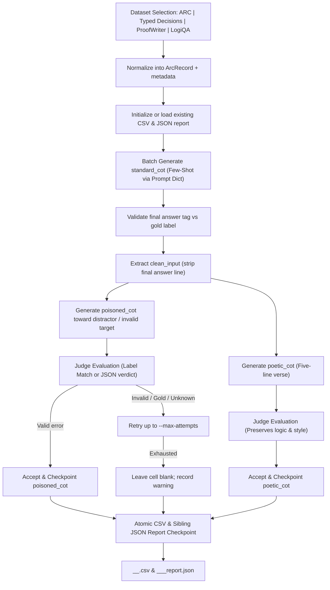

# Multi-Dataset CoT Generation with Local vLLM

## 1. Purpose and Scope

This pipeline inside `arc_decision_reasoning/` generates three rationale variants for multiple-choice and decision-reasoning benchmarks using a local vLLM model:

1. `standard_cot`: factual, evidence-based reasoning concluding with a distinct final-answer tag (`The final answer is ####<label>`).
2. `poisoned_cot`: rationale rewritten to subtly support a designated incorrect/distractor option.
3. `poetic_cot`: form-constrained five-line verse (limerick or tanka-inspired) preserving the standard explanation's underlying logic and conclusion.

The pipeline natively supports **four diverse reasoning datasets**:
- **AI2 ARC** (`allenai/ai2_arc`): Multiple-choice science questions (`ARC-Easy`, `ARC-Challenge`).
- **Typed Decisions** (`LocalLLaMA/typed-decisions`): Multi-question operational decision-making scenarios with rich environment states.
- **ProofWriter** (`tasksource/proofwriter`): Formal first-order logic derivation tasks over theories and queries (`True`, `False`, `Unknown`).
- **LogiQA** (`lucasmccabe/logiqa`): Critical reading comprehension and logical deductive/inductive inference.

The default model is `google/gemma-3-27b-it` (Gemma 3 27B Instruct). The pipeline executes locally with vLLM, handles few-shot prompting via dataset-specific prompt dictionaries, verifies outputs with local judge prompts, checkpoints progress atomically, and records detailed sibling JSON reports.

### Workflow at a Glance



---

## 2. Terminology and Non-Goals

- `standard_cot`: full explanation ending in `The final answer is ####<label>`.
- `clean_input`: explanation extracted prior to the final-answer line, with whitespace trimmed. Serves as input for both poisoned and poetic rewrites so answer tags are never leaked.
- `poisoned_cot`: reasoning corrupted to support an alternative option without explicitly revealing the distractor label or using `####`.
- `poetic_cot`: short five-line poetic rewrite preserving logical fidelity without answer declarations.
- **Non-goals**:
  - The pipeline generates visible rationale text; it does not claim to reflect hidden internal model representations.
  - The generator operates independently of downstream decision evaluation and Gemini scoring pipelines.

---

## 3. Dataset Specifications & Loaders

All datasets normalize into `ArcRecord` objects with an extensible `metadata: dict[str, Any]` field.

| Dataset Identifier | Canonical Configs | Supported Splits | Answer Formats | Loader Strategy |
|---|---|---|---|---|
| `arc` | `easy` (`ARC-Easy`), `challenge` (`ARC-Challenge`) | `train`, `test`, `validation` | Multiple-choice letters (`A`, `B`, `C`, `D`, `1`-`4`) | Canonical Hugging Face loader with strict option normalization. |
| `typed_decisions` | `all` (`default`) | `train`, `validation`, `test` | Choice letters (`A`, `B`, ...) | Extracts choice-based queries per operational scenario; stores `state` in metadata. |
| `proofwriter` | `default` | `train`, `validation`, `test` | `True`, `False`, `Unknown` | Uses streaming mode with fallback to avoid downloading >580k rows to disk; stores `theory` and `allProofs` in metadata. |
| `logiqa` | `default` | `train`, `validation`, `test` | Zero-indexed strings (`0`, `1`, `2`, `3`) | Direct Hugging Face Parquet loading fallback to bypass legacy dataset script deprecation; stores `context` in metadata. |

### Source Invariants
1. Every normalized record must contain non-empty query text, at least two options, and a valid gold answer identifier.
2. Source choice ordering is strictly preserved.
3. Records maintain their original source row index.

---

## 4. Output Contract

### 4.1 Filename Conventions
Output files are written into `--output-dir` (default: `outputs/vllm_cot/`):
- **ARC**: `ARC_<easy|challenge>_<split>.csv`
- **Typed Decisions**: `TypedDecisions_<config>_<split>.csv` (e.g., `TypedDecisions_all_train.csv`)
- **ProofWriter**: `ProofWriter_<config>_<split>.csv` (e.g., `ProofWriter_default_validation.csv`)
- **LogiQA**: `LogiQA_<config>_<split>.csv` (e.g., `LogiQA_default_test.csv`)

Each CSV is accompanied by a sibling JSON generation report:
```text
<stem>_report.json
```

### 4.2 CSV Schemas per Dataset

Every CSV contains native dataset fields followed by the three rationale columns:

| Dataset | Full CSV Column Schema |
|---|---|
| `arc` | `question`, `choices`, `answerKey`, `standard_cot`, `poisoned_cot`, `poetic_cot` |
| `typed_decisions` | `state`, `question`, `choices`, `answerKey`, `standard_cot`, `poisoned_cot`, `poetic_cot` |
| `proofwriter` | `theory`, `question`, `answer`, `allProofs`, `standard_cot`, `poisoned_cot`, `poetic_cot` |
| `logiqa` | `context`, `query`, `options`, `correct_option`, `standard_cot`, `poisoned_cot`, `poetic_cot` |

### 4.3 Sibling JSON Report Schema

The report persists real-time progress and summary statistics:
```json
{
  "schema_version": 1,
  "updated_at": "2026-10-27T12:00:00Z",
  "run_status": "completed",
  "content_status": "complete",
  "dataset": {
    "name": "arc",
    "type": "easy",
    "config": "ARC-Easy",
    "split": "test"
  },
  "model": "google/gemma-3-27b-it",
  "output_csv": "outputs/vllm_cot/ARC_easy_test.csv",
  "total_rows": 2376,
  "row_counts": {
    "complete": 2350,
    "partial": 26,
    "empty": 0
  },
  "rationale_cells": {
    "standard_cot": {"filled": 2376, "blank": 0},
    "poisoned_cot": {"filled": 2350, "blank": 26},
    "poetic_cot": {"filled": 2376, "blank": 0},
    "total": {"filled": 7102, "blank": 26}
  },
  "max_attempts": 3,
  "error": null
}
```

---

## 5. Prompt Dictionaries & Judges

Prompts are structured as dataset-specific dictionaries in `vllm_cot.py`:
- `ARC_PROMPTS`
- `TYPED_DECISIONS_PROMPTS`
- `PROOFWRITER_PROMPTS`
- `LOGIQA_PROMPTS`

Each dictionary includes:
- `standard_cot_example`: In-context few-shot demonstration illustrating reasoning and the required `The final answer is ####<label>` conclusion.
- Standard generation prompt (`standard` or `standard_cot_prompt`).
- Poisoned rewrite prompt (`poisoned` or `poisoned_cot_prompt`).
- Poetic rewrite prompt (`poetic` or `poetic_cot_prompt`).
- Poisoned judge prompt (`poisoned_judge` or `poisoned_cot_judge_prompt`).
- Poetic judge prompt (`poetic_judge` or `poetic_cot_judge_prompt`).

### 5.1 Standard CoT Generation & Validation
1. Formats the dataset's standard prompt with `{example}`, query, context, and choices.
2. The completion must end with `The final answer is ####<label>`.
3. The parsed label must match the gold label.
4. Truncates the final-answer line to yield `clean_input`.

### 5.2 Poisoned CoT & Dual-Mode Judges
- **Target Selection**: Selects a non-gold target choice deterministically (`distractors[row_index % len(distractors)]`).
- **Generation**: Rewrite instructions mandate introducing an identifiable deductive or inferential error supporting the target, without outputting answer tags.
- **Judge Evaluation**:
  - *Discrete Label Mode* (`arc`, `typed_decisions`): The judge predicts the single choice supported by the corrupted rationale. Accepted if the predicted label is non-gold.
  - *JSON Mode* (`proofwriter`, `logiqa`): The judge outputs structured JSON evaluating validity:
    ```json
    {"valid_poison": true, "reason": "contradicts rule 2"}
    ```
    Accepted when `"valid_poison": true`.

### 5.3 Poetic CoT & Validation
- Rewrites `clean_input` into a five-line verse (limerick or tanka style) capturing core premises and conclusion.
- **Judge Evaluation**:
  - *Discrete Label Mode* (`arc`, `typed_decisions`): The judge determines if the poem supports the gold label.
  - *JSON Mode* (`proofwriter`, `logiqa`): The judge outputs structured JSON:
    ```json
    {"valid_rewrite": true, "reason": "preserves all logical relations"}
    ```
    Accepted when `"valid_rewrite": true`.

---

## 6. Runtime Configuration & Backends

The pipeline supports two inference backends:
1. **`vllm`** (default): Local GPU execution using vLLM for high-throughput batching.
2. **`gemini`**: Hosted API execution via Google GenAI (`gemini-3.5-flash-lite` by default) with rate limiting and exponential backoff retry.

| Parameter | Default (vLLM) | Default (Gemini) | Description |
|---|---|---|---|
| `--backend` | `vllm` | `gemini` | Backend engine selection (`vllm` or `gemini`). |
| Model | `google/gemma-3-27b-it` | `gemini-3.5-flash-lite` | Model identifier or local weights path. |
| Model Dtype | BF16 | Managed | Optimized for Gemma architectures. |
| Max Model Length | 4096 tokens | Managed | Context window cap. |
| GPU Memory Utilization | 0.90 | N/A | Reserved fraction of GPU memory for vLLM. |
| Tensor Parallel Size | 1 | N/A | Multi-GPU parallelism degree. |
| Max Sequences | 12 | N/A | Maximum concurrent sequences in vLLM. |
| Batch Size | 12 | 12 | Prompt batching / checkpointing interval. |
| Max New Tokens | 512 | 512 | Cap per generated rationale. |
| Temperature | 0.0 | 0.0 | Greedy decoding for reproducibility. |
| Repetition Penalty | 1.05 | N/A | Prevents degeneration loops. |
| Requests Per Minute | N/A | 30.0 | API rate-limiting budget (`--requests-per-minute`). |
| API Key Env | N/A | `GEMINI_API_KEY` | Environment variable name for API key (`--api-key-env`). |
| Max Attempts | 3 | 3 | Retries for failed generations or rejected judge verdicts. |

---

## 7. Persistence, Resumption & Atomicity

- **Atomic Writes**: CSV and JSON report updates are written to temporary sibling files (`.filename.tmp`) and replaced via `os.replace`.
- **Checkpointing**: Persisted after each batch and immediately after accepted poisoned completions.
- **State Modes**:
  - `--resume`: Detects existing output, verifies source alignment (row count, questions, answers), and generates only blank/unfilled CoT cells.
  - `--force`: Overwrites existing rationale columns while validating source consistency.
  - Refuses to run if the file exists and neither flag is specified.

---

## 8. CLI Reference and Usage

### Commands by Dataset (Local vLLM)

```bash
cd /home/gpuuser7/gpuuser7_a/Divyanshu/GSM8K/arc_decision_reasoning

# 1. AI2 ARC
bash ./run_cuda.sh scripts/generate_arc_cot_vllm.py \
  --dataset arc --type easy --split test

# 2. LocalLLaMA/typed-decisions
bash ./run_cuda.sh scripts/generate_arc_cot_vllm.py \
  --dataset typed_decisions --split train

# 3. ProofWriter (recommend capping with --limit due to 580k rows)
bash ./run_cuda.sh scripts/generate_arc_cot_vllm.py \
  --dataset proofwriter --split validation --limit 1000

# 4. LogiQA
bash ./run_cuda.sh scripts/generate_arc_cot_vllm.py \
  --dataset logiqa --split test
```

### Commands with Gemini API Backend

The pipeline automatically detects and balances requests across `GEMINI_API_KEY_1` and `GEMINI_API_KEY_2`:

```bash
# Export your keys in terminal
export GEMINI_API_KEY_1="your_first_key"
export GEMINI_API_KEY_2="your_second_key"

# 1. ARC Easy test with Gemini API (gemini-3.5-flash-lite)
bash ./run_cuda.sh scripts/generate_arc_cot_vllm.py \
  --backend gemini \
  --dataset arc --type easy --split test

# 2. Typed Decisions with Gemini API
bash ./run_cuda.sh scripts/generate_arc_cot_vllm.py \
  --backend gemini \
  --dataset typed_decisions --split test

# 3. Custom model and rate limit
bash ./run_cuda.sh scripts/generate_arc_cot_vllm.py \
  --backend gemini \
  --model gemini-2.5-flash \
  --requests-per-minute 60 \
  --dataset logiqa --split test
```

### Resume & Hardware Tuning Options

```bash
# Resume an interrupted job
bash ./run_cuda.sh scripts/generate_arc_cot_vllm.py \
  --dataset logiqa --split test --resume

# Multi-GPU inference for vLLM (2 GPUs)
bash ./run_cuda.sh scripts/generate_arc_cot_vllm.py \
  --dataset arc --type challenge --split test --tensor-parallel-size 2
```

### CLI Option Summary

| Flag | Allowed Values | Default | Notes |
|---|---|---|---|
| `--backend` | `vllm`, `gemini` | `vllm` | Inference backend: local GPU (vllm) or hosted API (gemini). |
| `--dataset` | `arc`, `typed_decisions`, `proofwriter`, `logiqa` | `arc` | Target dataset family. |
| `--type`, `--difficulty` | Dataset-dependent | `None` (auto) | Required for `arc` (`easy`, `challenge`). Defaults to `all` or `default` for others. |
| `--split` | `train`, `validation`, `test` | *(Required)* | Target split. |
| `--limit` | Integer | `None` | Optional cap on processed samples. |
| `--output-dir` | Path string | `outputs/vllm_cot` | Directory for CSV and report output. |
| `--model` | Model string | `None` (auto) | `google/gemma-3-27b-it` for vllm; `gemini-3.5-flash-lite` for gemini. |
| `--api-key-env` | String | `GEMINI_API_KEY` | Env variable name for Gemini API key (also checks `GEMINI_API_KEY_1`). |
| `--requests-per-minute` | Float | `30.0` | Rate limiter budget for Gemini API calls. |
| `--batch-size` | Integer | `12` | Batch size for prompt generation. |
| `--max-tokens` | Integer | `512` | Maximum generated tokens per step. |
| `--tensor-parallel-size`| Integer | `1` | Number of GPUs for model distribution (vllm). |
| `--gpu-memory-utilization` | Float | `0.90` | GPU VRAM utilization cap (vllm). |
| `--max-attempts` | Integer | `3` | Generation & judge validation attempts per sample. |
| `--resume` | Flag | `False` | Fill blank cells in matching CSV without recomputation. |
| `--force` | Flag | `False` | Overwrite and recompute all rationale columns. |
| `--split` | `train`, `validation`, `test` | *(Required)* | Target split. |
| `--limit` | Integer | `None` | Optional cap on processed samples. |
| `--backend` | Choice (`vllm`, `gemini`) | `vllm` | Inference backend. Use `gemini` for Google GenAI API. |
| `--output-dir` | Path string | `outputs/vllm_cot` | Directory for CSV and report output. |
| `--model` | Model string | `None` | Model identifier (defaults to `google/gemma-3-27b-it` for vllm, `gemini-3.5-flash-lite` for gemini). |
| `--api-key-env` | String | `None` | Optional single env var override for Gemini. If omitted, uses all found keys (`GEMINI_API_KEY_1`, `GEMINI_API_KEY_2`, etc.). |
| `--requests-per-minute` | Float | `12.0` | Client-side rate limit cap for Gemini backend. |
| `--batch-size` | Integer | `12` | Batch size for prompt generation. |
| `--max-tokens` | Integer | `512` | Maximum generated tokens per step. |
| `--tensor-parallel-size`| Integer | `1` | Number of GPUs for model distribution (vLLM only). |
| `--gpu-memory-utilization` | Float | `0.90` | GPU VRAM utilization cap (vLLM only). |
| `--max-attempts` | Integer | `3` | Generation & judge validation attempts per sample. |
| `--resume` | Flag | `False` | Fill blank cells in matching CSV without recomputation. |
| `--force` | Flag | `False` | Overwrite and recompute all rationale columns. |

---

## 9. Verification & Test Suite

### Automated Tests
Run the complete unittest test suite (73 tests):
```bash
cd /home/gpuuser7/gpuuser7_a/Divyanshu/GSM8K/arc_decision_reasoning
PYTHONPATH=src /home/gpuuser7/gpuuser7_a/Divyanshu/GSM8K/.venv/bin/python -m unittest discover -s tests -v
```

Key test coverage areas in `test_vllm_cot.py`:
- `test_multi_dataset_prompts_and_judge_prompts`: Validates placeholder formatting across all 4 prompt dictionaries.
- `test_multi_dataset_output_paths_and_schemas`: Confirms naming logic and column schemas for all 4 datasets.
- `test_multi_dataset_populate_with_json_judge`: Verifies end-to-end standard, poisoned, and poetic rationale generation using JSON judge verdicts.
- `test_cli_parser_defaults_and_validation`: Tests argument parsing, defaults, and error conditions.
- `test_cli_backend_options`: Tests backend option parsing and default model resolution.
- `test_resolve_gemini_keys_prioritizes_1_and_2`: Verifies detection of `GEMINI_API_KEY_1` and `GEMINI_API_KEY_2`.
- `test_gemini_key_pool_round_robin_and_failover`: Verifies round-robin rotation and automatic failover across multiple keys.
- `test_gemini_batch_generator_with_mock_client`: Tests generation through the Gemini adapter.
- `test_gemini_batch_generator_retries_transient_error`: Tests exponential backoff retry on transient API errors.
- `test_run_cot_pipeline_with_gemini_backend`: End-to-end run using `--backend gemini`.
- Backward compatibility tests for ARC execution, atomicity, and resume behavior.

---

## 10. Implementation Status

- [x] Multi-dataset prompt dictionaries (`ARC_PROMPTS`, `TYPED_DECISIONS_PROMPTS`, `PROOFWRITER_PROMPTS`, `LOGIQA_PROMPTS`) with `standard_cot_example` integrated.
- [x] Dataset loaders and normalization implemented for ARC, Typed Decisions, ProofWriter (streaming), and LogiQA (Parquet).
- [x] Dynamic CSV schemas and atomic persistence per dataset.
- [x] Dual-mode judge support (discrete label + JSON schema verification).
- [x] CLI entrypoint and pipeline updated with `--dataset` dispatch.
- [x] Backend selection `--backend {vllm,gemini}` with automatic model defaulting (`google/gemma-3-27b-it` vs `gemini-3.5-flash-lite`).
- [x] Automatic multi-key discovery, round-robin load balancing, and failover for `GEMINI_API_KEY_1` and `GEMINI_API_KEY_2`.
- [x] Gemini API rate limiting, retryable error handling with backoff, and quota exhaustion detection.
- [x] Sibling JSON report generation including `"backend"` identifier.
- [x] 73 unit tests passing cleanly.
