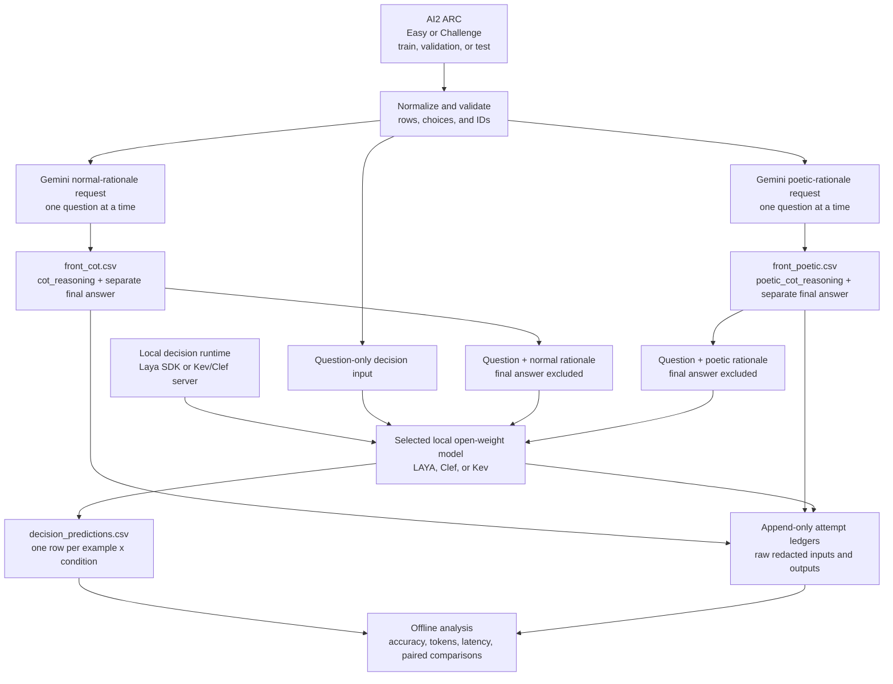

# ARC Reasoning-Style Transfer Experiment: Gemini to Decision Models

## 1. Purpose and Scope

Build a standalone subproject, `arc_decision_reasoning/`, that measures whether
Gemini-generated explanatory text helps a selected decision model choose the
correct answer to questions from `allenai/ai2_arc`.

For every ARC question, make two **independent, one-question-at-a-time**
Gemini requests:

1. Normal visible rationale: a concise, stepwise scientific explanation.
2. Poetic visible rationale: an explanation written in one fixed poetic form.

Gemini must return its selected answer in a distinct final-answer field. The
stored rationale/poem must not contain an answer label, an answer-choice
position, or a declaration of the selected choice. The decision model must
never receive Gemini's final answer.

Then ask the selected decision model to answer the same ARC question in three
independent conditions:

| Condition | Decision model receives |
| --- | --- |
| `question_only` | Question and ordered answer choices only |
| `normal_reasoning` | Question, choices, and `cot_reasoning` from `front_cot.csv` |
| `poetic_reasoning` | Question, choices, and `poetic_cot_reasoning` from `front_poetic.csv` |

The primary outcome is decision-model accuracy. Secondary outcomes are coverage,
Gemini/decision-model token usage, rationale length, latency, Gemini diagnostic
accuracy, and decision confidence/probabilities when exposed by the API.

### Workflow at a glance



This project is deliberately separate from the repository's vLLM/router
runners. It may reuse general coding conventions, but it must not couple this
Gemini-generation experiment to the repository's router-training/evaluation
pipeline. Laya, Kev, and Clef inference is intentionally local to this
subproject.

## 2. Terminology and Non-Goals

Use `cot_reasoning` and `poetic_cot_reasoning` as the required artifact names.
Internally, call the content a **visible rationale** or **visible explanation**.
The experiment must not claim access to Gemini's private hidden reasoning.
Only text intentionally returned by the selected Gemini API/model is stored or
evaluated.

The experiment measures whether supplied explanatory text changes the selected
model's decision accuracy. It does not establish that Gemini's visible rationale
is a faithful record of its internal reasoning.

Do not ask the decision model for a written rationale, and do not manufacture
one. It is used only as a bounded answer-choice decision model.

## 3. Experimental Design

### 3.1 Dataset matrix

Load the Hugging Face dataset with:

```python
load_dataset("allenai/ai2_arc", config_name, split=split_name)
```

Supported canonical configurations are:

| CLI value | Hugging Face configuration |
| --- | --- |
| `easy` | `ARC-Easy` |
| `challenge` | `ARC-Challenge` |

`normal` is not an ARC configuration. It may be accepted only as a documented
alias for `challenge`, with the manifest always recording `ARC-Challenge`.

Supported splits are `train`, `validation`, and `test`; default to `test`.
Configuration and split must be runtime options and must be written to every
durable result record.

### 3.2 Poetic-form control

The poetic condition must use one form per run:

```text
--poem-form haiku | tanka | limerick
```

Do not use a random mixture of forms in one `poetic_reasoning` condition. A
mixed condition would confound poetic form with explanation style. To compare
forms, run separate, independently identifiable experiments, each with its own
output directory and `front_poetic.csv`.

Default to `tanka` because it provides enough room for a substantive science
explanation. The requested form, returned form, and lightweight form-validation
status must be retained for every poetic result. Form validation is descriptive;
never silently rewrite a poem.

### 3.3 Decision-model selection

Select exactly one decision model for each run:

```text
--decision-model {laya,clef,kev}
```

`LAYA`, `Clef`, and `Kev` are separate experimental factors, not interchangeable
aliases. They are Apache-2.0 open-weight Hugging Face models, so each run must be
executed locally on the experimenter's hardware. Record the selected Hugging Face
repository/revision, local runtime or server version, device, dtype, adapter
version, and model-specific request configuration in the run manifest, attempt
ledgers, output rows, and cache keys.

Run the full A/B/C condition set independently for each selected decision model.
Do not pool their predictions into one accuracy value. To compare LAYA, Clef,
and Kev, use a separate run directory for each model or a parent experiment
directory containing one immutable run per model.

### 3.4 Fixed comparison rules

Before a full run, record the following in `manifest.json`:

- primary metric: shared-completion decision-model accuracy;
- primary comparisons: normal minus question-only, poetic minus question-only,
  and normal minus poetic;
- confidence level and paired statistical procedure;
- leakage handling and exclusion policy;
- models, prompt-template hashes, generation parameters, and dataset revision.

Use exactly the same question text, choice labels, choice order, selected
decision model, and decision instruction for all three conditions. The only
intended difference between conditions is the presence and type of supplied
rationale.

## 4. Dataset Preparation

Normalize every ARC row into a canonical record before any Gemini request or
local decision inference:

```json
{
  "example_id": "arc_easy__test__000123",
  "dataset_id": "allenai/ai2_arc",
  "dataset_config": "ARC-Easy",
  "split": "test",
  "source_row_index": 123,
  "question": "...",
  "choices": [{"label": "A", "text": "..."}],
  "gold_answer_label": "B",
  "gold_answer_text": "..."
}
```

Requirements:

- Preserve choice order and original labels.
- Normalize labels and answer keys conservatively; validate that the gold key
  maps to exactly one available choice.
- Never send gold-answer fields to Gemini or the decision model.
- Use a stable ID based on configuration, split, and original row index if the
  dataset does not provide a stable source ID.
- Record skipped/invalid rows and their reason. In `--strict` mode, fail before
  any model calls if any invalid row is found.
- Save the normalized dataset as an immutable `dataset_records.jsonl` plus a
  `dataset_manifest.json` containing row counts, skipped IDs, Hugging Face
  dataset revision/fingerprint, library version, and a content hash.

The normalized-record content hash is part of every generation and decision
cache key. A changed dataset snapshot must create a new run rather than reuse
old model outputs.

## 5. Runtime Contracts and Secrets

### 5.1 Gemini adapter

Use the current official Google Gen AI SDK behind one `gemini_client.py`
adapter. The adapter is the only place that knows SDK request/response details.

- Read the environment variable named by `gemini_api_key_env` in the YAML
  configuration (default: `GEMINI_API_KEY`). Store the key value only in the
  environment, never in YAML.
- Make a single Gemini request for a single example and task.
- Configure the model ID, temperature, seed where supported, timeout, retry
  policy, and response schema through CLI/configuration.
- Default new runs to `gemini-3.5-flash-lite`; Gemini 2.5 model access may be
  restricted for projects that have not previously used those models.
- Pace requests using `--gemini-requests-per-minute` (default: 4) to control the
  local request rate, and record the configured pace in the run manifest. This
  does not increase or guarantee the provider's account/project quota.
- Prefer the API's supported JSON-schema/structured-output mechanism.
- Store the exact configured Gemini model ID and response model/version field,
  if available; do not substitute a marketing name.
- Persist API usage metadata exactly as returned, including prompt, candidate
  output, and total token counts when exposed.

The adapter must never log authorization headers, API keys, or complete
environment variables.

The `run_cuda.sh`, `run_kev_server.sh`, and `run_clef_server.sh` launchers source
`arc_decision_reasoning/.env` when present. `.env.example` selects GPU 0,
`LAYA_DEVICE=cuda`, BF16 for Kev, and `Cloudflare/clef-flash` by default.

### 5.2 Local decision-model adapters

Use one generic `decision_client.py` interface with dedicated local adapters for
`laya`, `clef`, and `kev`. None of these runs may depend on a hosted decision API
or its credentials.

- **Laya:** use the local `laya` Python runtime with
  `convaiinnovations/laya` (or an explicitly recorded checkpoint such as its
  typed-decision variant). It returns bounded Choice answers in-process.
- **Kev:** self-host `jaredpalmer/kev-4b` using its documented local server, then
  call the loopback `/v1/systemone` endpoint. Its model server returns the
  SystemOne Choice response schema.
- **Clef:** default to `Cloudflare/clef-flash`; select `Cloudflare/clef` explicitly
  for the 27B variant. Use the documented local SGLang server and loopback
  `/v1/systemone` endpoint for either variant.

### 5.2.1 Local runtime preflight

Run a local preflight before any paid Gemini collection or full ARC evaluation.
The preflight must load or contact only the selected decision model, submit one
bounded Choice question, validate the returned label/probabilities, and write the
observed runtime metadata to the run manifest.

- **Laya:** install the optional local runtime, for example
  `pip install -e '.[laya]'`, then use `LayaLocalClient` directly. The first
  load downloads `convaiinnovations/laya` weights to the local Hugging Face
  cache. Record `LAYA_CHECKPOINT`, `LAYA_DEVICE`, preload state, package version,
  and the routed/loaded checkpoint reported by the result. On CUDA hosts, launch
  the project CLI through `arc_decision_reasoning/run_cuda.sh`, which sets the
  CUDA library path before Python starts and defaults `LAYA_DEVICE=cuda`.
- **Kev:** start the documented local server for `jaredpalmer/kev-4b` before
  evaluation. Its default loopback endpoint is
  `http://127.0.0.1:8008/v1/systemone`. Record the server command/version,
  model revision, endpoint, device, dtype, and optional local authentication
  setting. The project's `run_kev_server.sh` sets CUDA visibility, BF16, and
  `LD_LIBRARY_PATH` before launching the Python server. Do not send this endpoint
  or data to a hosted API.
- **Clef:** start the documented local SGLang server for `Cloudflare/clef` or
  explicitly selected `Cloudflare/clef-flash` before evaluation. Its default
  loopback endpoint is `http://127.0.0.1:30000/v1/systemone`. Record the
  model/variant, image or runtime version, model revision, device, dtype, and
  endpoint. The project launcher uses Docker GPU passthrough and defaults to
  `Cloudflare/clef-flash`. The 27B Clef and 9B Clef-Flash variants are different
  experiments and must not share a `run_id`.

The decision-model preflight has no hosted inference fee, but it does consume
local compute, storage, and electricity. Do not auto-download, auto-launch, or
switch decision models midway through a recorded run.

Before a full run, verify each selected local runtime/server with a mocked or
small real response for its bounded Choice schema, selected label,
confidence/probabilities, usage fields where exposed, model/version, and errors.
The common adapter must normalize each response into the same bounded-choice
result. If a metric is not exposed by a selected local runtime, store `null`;
optionally record an estimate in a separate, explicitly named field.

### 5.2.2 Native decision-model fine-tuning

Provide separate launchers for Laya, Kev, and Clef plus one model-selecting
wrapper. The launchers support fine-tuning across all project reasoning datasets
selectable purely from CLI parameters:
- `arc` (`allenai/ai2_arc`): `--difficulty {easy,challenge}` or `--dataset-config {easy,challenge}`, mapping to `ARC-Easy` and `ARC-Challenge`.
- `typed_decisions` (`LocalLLaMA/typed-decisions`): `--dataset-config {all,customer_service,invoice_processing,security_incidents,agent_trace_observability}` (default: `all`).
- `proofwriter` (`tasksource/proofwriter`): `--dataset-config default` (default: `default`).
- `logiqa` (`lucasmccabe/logiqa`): `--dataset-config default` (default: `default`).

Fine-tuning uses only the source `train` split against the golden/correct answers.
Use the source `validation` split for monitoring; if it is unavailable or empty
(such as for `typed_decisions`), create a seeded 10% holdout from normalized training
records and record that fallback in the data manifest (`validation_source: "train_holdout"`).
Do not use `test` for training or monitoring.

For every model, keep the scenario context in `state`, define one Choice question
with the ordered dataset labels mapped to their source texts, and keep the gold answer
only in the native label location:

- **State Representation by Dataset:**
  - `arc`: `{"question": record.question}`
  - `logiqa`: `{"context": record.metadata["context"], "question": record.question}`
  - `proofwriter`: `{"theory": record.metadata["theory"], "question": record.question}`
  - `typed_decisions`: scenario environment state dict or string merged with `"question"`.

- **Model-Specific System One Contracts:**
  - **Laya:** Write `{state, questions, expected}` JSONL. The answer belongs in
    `expected.arc_answer`. Invoke the native `laya-train` CLI with `--data` for
    train data, `--eval` for validation data, `--base`, `--out`, and `--device`.
  - **Kev:** Write each JSONL line as a labelled System One request:
    `{state, questions}`, where `questions.arc_answer.label` is the answer key.
    Invoke `uv run python -m kev.train --data ... --init_from ... --out ...`,
    then invoke native `kev.benchmark --run ... --data <validation>` for
    validation monitoring.
  - **Clef:** Write `{id, state, questions, labels}` JSONL. The answer belongs in
    `labels.arc_answer`, which is Clef's native expected-label mapping. Generate a
    `clef-finetune` configuration whose `data.train` and `data.eval` paths point
    to these artifacts, invoke `clef-finetune train <config> --output-dir ...`,
    then run `clef-finetune eval --compare-base` on validation against the final
    native checkpoint.

The default output roots are distinct by model, dataset, and configuration:
`outputs/finetunes/<model>_<dataset>_<config>/` (for ARC: `outputs/finetunes/<model>_arc_<difficulty>/`).
Save native data under `data/`, the actual learned artifact under `checkpoint/`,
validation reports under `validation_monitoring/`, and data/command metadata alongside them.
The wrapper may prepare data or print commands without invoking a trainer, but it must never
replace a native trainer with a generic Transformers loop.

#### Replacing fine-tuned models
- **Replace/Overwrite Checkpoints:** Pass `--replace` (or `--overwrite`) to cleanly remove
  and replace any existing run/checkpoint directory so a new fine-tuned model replaces the previous
  one without directory collision errors.
- **Warm-Start / Base Model Replacement:** Pass `--base-model <path_or_id>` to initialize
  or continue fine-tuning from an existing fine-tuned checkpoint (passed to `laya-train --base`,
  `kev.train --init_from`, or Clef's `model.path`).

#### Training commands

Run these from `arc_decision_reasoning/`. Install the optional native tools in
the Python environment used by `run_cuda.sh` as needed. The Kev repository
argument must point to the checkout containing its `pyproject.toml`; the current
nested checkout uses `kev/kev`.

```bash
# Laya on ARC-Easy
python -m pip install -e '.[laya]'
bash ./run_cuda.sh scripts/finetune_laya.py --difficulty easy

# Kev on LogiQA
bash ./run_cuda.sh scripts/finetune_kev.py \
  --dataset logiqa \
  --kev-repo-dir "$PWD/kev/kev"

# Clef on ProofWriter
python -m pip install clef-finetune
bash ./run_cuda.sh scripts/finetune_clef.py --dataset proofwriter

# Laya on Typed Decisions (replace existing output directory)
bash ./run_cuda.sh scripts/finetune_laya.py \
  --dataset typed_decisions --dataset-config all --replace

# Warm-start fine-tuning from a previous checkpoint (replacing base model)
bash ./run_cuda.sh scripts/finetune_decision_model.py \
  --model laya --dataset logiqa \
  --base-model outputs/finetunes/laya_arc_easy/checkpoint

# Optional: prepare native artifacts and print commands without training.
bash ./run_cuda.sh scripts/finetune_decision_model.py \
  --model kev --difficulty easy --dry-run \
  --kev-repo-dir "$PWD/kev/kev"
```

Use `--difficulty challenge` for ARC-Challenge. For a small data smoke test,
add `--limit 5 --validation-limit 5` and a dedicated `--output-dir`; do not use
that partial run as the full fine-tune. `--prepare-only` writes data without
starting a trainer, while `--dry-run` also prints the native command. For Kev,
`--base-model` is the warm-start checkpoint passed to `--init_from`, whereas
`--kev-base-model` is the underlying architecture passed to `--base`. The
default 4B checkpoint supplies its matching Qwen 3.5 4B architecture
automatically; when overriding the checkpoint, set its architecture explicitly.

Each completed launcher also runs its model-native validation monitor. Kev's
`kev.benchmark` and Clef's `clef-finetune eval --compare-base` reports are
written under `validation_monitoring/`; they are not the separate experiment
evaluation on ARC test data. Inspect `dataset_manifest.json` and
`native_commands.json` in the fine-tuning run directory to verify the data
counts, selected checkpoint, and exact commands.

Use a new `--output-dir` for each new fine-tune or retry. In particular,
`kev.train` refuses an existing `--out` directory, even if it is empty, and its
`--resume` option is only for full-weight runs (`--full_ft 1`), not the default
LoRA run. A failed run can therefore be retried safely in a new directory such
as `outputs/finetunes/kev_arc_easy_retry/`; preserve the old run for inspection.

#### Evaluate a fine-tuned checkpoint

Native validation monitoring does not replace the project's three-condition
evaluation. For that evaluation, first prepare ARC `test` data and generate
both rationale files in a fresh `EVAL_DIR`, then evaluate and analyze that same
directory. Give every model/checkpoint identity its own evaluation directory;
do not switch checkpoints after decision attempts have been recorded. The
example below evaluates fine-tuned Laya end to end:

```bash
EVAL_DIR=outputs/arc_easy_laya_ft

bash ./run_cuda.sh -m arc_decision.cli prepare \
  --dataset-config easy --split test --output-dir "$EVAL_DIR"

bash ./run_cuda.sh -m arc_decision.cli generate \
  --dataset-config easy --split test \
  --gemini-model gemini-3.5-flash-lite --poem-form tanka \
  --output-dir "$EVAL_DIR" --resume

bash ./run_cuda.sh -m arc_decision.cli evaluate \
  --output-dir "$EVAL_DIR" --decision-model laya \
  --laya-finetuned-checkpoint outputs/finetunes/laya_arc_easy/checkpoint \
  --resume

bash ./run_cuda.sh -m arc_decision.cli analyze --output-dir "$EVAL_DIR"
```

For Kev, set `KEV_MODEL_ID` in `arc_decision_reasoning/.env` to the absolute
path of its trained `checkpoint/` directory, then start
`bash ./run_kev_server.sh` in a separate terminal. Prepare and generate test
data in a fresh directory such as `outputs/arc_easy_kev_ft`, then run
the evaluation stages on that same directory:

```bash
bash ./run_cuda.sh -m arc_decision.cli evaluate \
  --output-dir outputs/arc_easy_kev_ft --decision-model kev --resume
bash ./run_cuda.sh -m arc_decision.cli analyze \
  --output-dir outputs/arc_easy_kev_ft
```

The local evaluator uses the model selected by the server; no
fine-tuned-checkpoint CLI flag is needed for Kev.

Clef fine-tuning saves an adapter-plus-head checkpoint. To serve it through the
project's Docker-based evaluator, first merge it into a release-format model.
For the default 500-step run, place the merged files under the host Hugging Face
cache, which `run_clef_server.sh` mounts into the container:

```bash
HF_CACHE="${HF_HOME:-$HOME/.cache/huggingface}"
clef-finetune merge \
  --model Cloudflare/clef-flash \
  --checkpoint outputs/finetunes/clef_arc_easy/checkpoint/checkpoint-500 \
  --output "$HF_CACHE/arc_decision_reasoning/clef_arc_easy_merged"
```

Set `CLEF_MODEL_ID=/root/.cache/huggingface/arc_decision_reasoning/clef_arc_easy_merged`
in `arc_decision_reasoning/.env`, then start `bash ./run_clef_server.sh` in a
separate terminal. Prepare and generate test data in a fresh directory such as
`outputs/arc_easy_clef_ft`, then run:

```bash
bash ./run_cuda.sh -m arc_decision.cli evaluate \
  --output-dir outputs/arc_easy_clef_ft --decision-model clef --resume
bash ./run_cuda.sh -m arc_decision.cli analyze \
  --output-dir outputs/arc_easy_clef_ft
```

If training with a non-default `--clef-max-steps N`, merge `checkpoint-N`
instead. The project evaluator still uses the local `/v1/systemone` server;
the native Clef validation report remains available separately under the
fine-tuning run directory.

### 5.3 Run configuration

Keep defaults in `configs/experiment.yaml`, including `gemini_api_key_env` and
`output_dir`, with CLI values taking precedence where corresponding flags exist.
The YAML stores only the environment variable name, not the Gemini API key.
Commit `.env.example` containing only Gemini credentials and local model/server
configuration. Never commit a real API key, API response containing credentials,
or request headers. Kev and Clef server credentials are optional only when the
experimenter enables authentication on their own local loopback server.

## 6. Gemini Generation Contracts

Both tasks receive the same normalized question and ordered choices. They are
separate requests, and a failure in one does not suppress the other.
The prompt templates below match `build_gemini_prompt()` in
`arc_decision_reasoning/src/arc_decision/prompts.py`. At request time,
`<QUESTION_DATA_JSON>` is replaced by the indented JSON serialization of the
question and ordered labeled choices only; it contains no gold-answer fields.
The poetic prompt replaces `{poem_form}` and
`{FORM_SPECIFIC_VERSE_INSTRUCTIONS}` with the form selected for the run.

### 6.1 Normal rationale task

Ask Gemini to return a schema equivalent to:

```json
{
  "reasoning": "A concise stepwise scientific explanation.",
  "final_answer_label": "B",
  "final_answer_text": "The source text of option B"
}
```

The prompt must require the model to write the visible explanation first and
the final answer only in `final_answer_label`/`final_answer_text`. In the
`reasoning` value it must not mention an option label, option number, exact
choice text, or use phrases such as "the correct answer is".

The normal prompt is:

```text
Solve the following multiple-choice science question. Write a concise, stepwise scientific explanation that would help a separate decision system reason about the question without revealing your selection. Do not put an answer label, option number, exact answer-choice text, or a statement of the selected answer in reasoning. Put the selected answer only in final_answer_label and final_answer_text. Return only an object that matches the requested JSON schema with reasoning, final_answer_label, and final_answer_text.

Question data:
<QUESTION_DATA_JSON>
```

### 6.2 Poetic rationale task

Ask Gemini to return a schema equivalent to:

```json
{
  "poem_form": "tanka",
  "reasoning": "A scientific explanation as a tanka.",
  "final_answer_label": "B",
  "final_answer_text": "The source text of option B"
}
```

The prompt must require the requested fixed form and impose the same
answer-separation rule as the normal task. A poem may be concise, but it still
has to contain an explanatory scientific rationale rather than a mnemonic or a
bare answer.

The poetic prompt is:

```text
Solve the following multiple-choice science question. Write a scientifically meaningful explanation as a {poem_form}. {FORM_SPECIFIC_VERSE_INSTRUCTIONS} Make the verse a coherent scientific explanation, not prose broken into lines or disconnected brief statements. Include only the verse in reasoning, without a title or prefatory text. Do not put an answer label, option number, exact answer-choice text, or a statement of the selected answer in reasoning. Put the selected answer only in final_answer_label and final_answer_text. Return only an object that matches the requested JSON schema with reasoning, final_answer_label, and final_answer_text. Also set poem_form to "{poem_form}".

Question data:
<QUESTION_DATA_JSON>
```

`{FORM_SPECIFIC_VERSE_INSTRUCTIONS}` is selected as follows:

- **Haiku:** Write exactly three non-empty verse lines in `reasoning`, separated
  by newline characters. Aim for an English 5-7-5 syllable pattern. Use a
  concrete image and meaningful juxtaposition to express an accurate scientific
  insight.
- **Tanka:** Write exactly five non-empty verse lines in `reasoning`, separated
  by newline characters. Aim for an English 5-7-5-7-7 syllable pattern. Develop
  from a concrete image to an accurate scientific insight, using vivid imagery,
  a metaphor, and a clear turn.
- **Limerick:** Write exactly five non-empty verse lines in `reasoning`, separated
  by newline characters. Use an AABBA end-rhyme scheme, with lines 1, 2, and 5
  longer than lines 3 and 4. Use a lively rhythm and playful wordplay while
  keeping the science accurate.

For a retry after a possible answer leak, append this sentence to the shared
answer-separation instruction in either prompt:

```text
This is a retry because a prior rationale risked leaking the answer; be especially strict.
```

### 6.3 Parsing and answer separation

For both tasks:

1. Validate structured output and trim only outer whitespace.
2. Validate `final_answer_label` against that example's available labels.
3. Validate `final_answer_text`, when supplied, against the matching source
   choice after documented normalization.
4. Store a parse/validation status rather than guessing a replacement label.
5. Retry bounded transient failures such as short rate limits and temporary
  server errors, honoring a provider retry delay when exposed and otherwise
  using exponential backoff. When a 429 explicitly reports a quota or request
  limit as exceeded, record and checkpoint that failure, then stop the entire
  generation stage without sending any more Gemini requests. A composed `run`
  must not proceed to evaluation or analysis after this stop. After the provider
  quota resets or is increased, `--resume` can retry failed and unsubmitted
  tasks. Do not repeatedly retry invalid requests, authentication/permission
  failures, or unavailable models.

Never repair a failed output by inferring an answer from its rationale. Never
rewrite a valid rationale solely to make it fit a desired format.

### 6.4 Leakage policy

No automatic rule can prove that an explanation does not semantically reveal an
answer. Therefore use a transparent, two-level policy:

- **Hard flag:** answer-label patterns, option-position references, final-answer
  markers, or embedded final-answer fields in the saved rationale.
- **Review flag:** normalized exact-choice-text overlap or another ambiguous
  indicator. Such overlap can be legitimate for common science terms.

On a hard flag, retry generation up to the configured bounded maximum with a
more explicit separation instruction. If it remains flagged, preserve the raw
result but mark it `leakage_status=hard_flagged`; do not mutate or redact it.
Do not send a hard-flagged rationale to the decision model by default.

The primary paired analysis uses examples with clean, valid reasoning in both
augmented conditions. Also report a sensitivity analysis that includes eligible
flagged cases only when explicitly requested. Store enough metadata for manual
audit. This avoids silently changing the text that the decision model actually
sees.

### Separate local vLLM CoT generation and judging

The standalone `arc_decision_reasoning/scripts/generate_arc_cot_vllm.py`
pipeline is separate from the Gemini generation path above. It uses local vLLM
with `google/gemma-3-27b-it` by default and writes
`outputs/vllm_cot/ARC_<type>_<split>.csv` with exactly these columns:

```text
question,choices,answerKey,standard_cot,poisoned_cot,poetic_cot
```

The CSV stores the source answer key, but prompts do not include an `answerKey`
field. The standard prompt receives a labeled ARC example, the question, and
ordered choices. Its completion must end in exactly one line of the form
`The final answer is ####<choice_label>`. Validate that the label is available
for the row and equals `answerKey`; require a non-empty explanation before the
line and no trailing text. The accepted standard output retains that final line.
Define `clean_input` as only the explanation preceding the final-answer line.

The poisoned and poetic variants are rewrites of `clean_input`, never of the
complete standard output. Validate them independently as follows:

- **`poisoned_cot`:** Choose a deterministic target from the row's non-gold
  choices and give its label and text to the corruption prompt. A separate
  judge completion receives the question, choices, and corrupted explanation,
  and chooses the label most directly supported by that explanation, even if
  scientifically wrong. Parse the judge result as one source label. Accept the
  corruption only when the selected label is not `answerKey`. The target
  distractor guides generation; the current acceptance rule requires any
  unambiguous non-gold label, not necessarily the assigned target. Malformed or
  gold-label verdicts fail validation.
- **`poetic_cot`:** Rewrite `clean_input` as an explanatory five-line poem. A
  separate judge completion receives the question, choices, and poem, and must
  return exactly one supported source label or `UNKNOWN`. The judge must
  interpret the poem in context without supplying missing scientific reasoning
  or substituting its own answer based on outside knowledge. Accept the poem
  only when the parsed label exactly equals `answerKey`. A wrong label,
  `UNKNOWN`, or ambiguous/malformed verdict is a failed attempt, not a correct
  answer. The judge prompt is:

  ```text
  Read the ARC multiple-choice science question, its choices, and the explanatory poem below. Select the one choice label most directly supported by the poem. Interpret poetic language in context, but do not supply missing scientific reasoning or select an answer using your own knowledge instead of the poem. If the poem supports a scientifically incorrect choice, select that choice anyway. If no single choice is clearly supported, output UNKNOWN.

  Output only the supported choice label exactly as provided, or UNKNOWN, and no other text.

  Question: {question}
  Choices:
  {choices}
  Explanatory poem:
  {poetic_input}

  Supported choice label:
  ```

For standard, poisoned, and poetic outputs, `--max-attempts` is the total
number of attempts per row, including the initial attempt. A poisoned or poetic
attempt consists of one generation completion plus one separate judge
completion. On acceptance, checkpoint that cell immediately. On exhaustion,
leave only that cell blank, log a warning, and continue other rows and later
stages when their prerequisite `clean_input` is available. Failed standard
validation leaves that row's standard and dependent cells blank; it does not
abort valid rows in the same batch. A blank cell can be retried with `--resume`.

`--resume` preserves non-empty cells and regenerates blanks; it does not judge
already populated cells again. `--force` regenerates all three rationale
columns and reruns their validations. Because the six-column CSV does not retain
judge outputs, verdicts, or prompt hashes, use a new output directory or
`--force` when a changed prompt or judging policy must be applied to previously
accepted content. This local vLLM judging is a consistency check, not proof of
semantic correctness; a judge can share the generator's biases.

## 7. Durable Storage and Resumption

CSV is required for convenient inspection, but it is not the canonical
multi-attempt store. Use this hierarchy within one immutable run directory:

```text
arc_decision_reasoning/outputs/<run_id>/
  manifest.json
  dataset_records.jsonl
  dataset_manifest.json
  attempts/
    gemini_attempts.jsonl
    decision_attempts.jsonl
  front_cot.csv
  front_poetic.csv
  decision_predictions.csv
  per_question_comparison.csv
  summary.csv
  token_latency_summary.csv
  errors.csv
  analysis/
  states/
```

The CLI anchors `--output-dir` to the `arc_decision_reasoning/` project
directory, independent of the current working directory. Relative paths resolve
under that directory, and absolute paths outside it are rejected. If the CLI
option is omitted, `output_dir` from `configs/experiment.yaml` supplies the
default.

`attempts/*.jsonl` are append-only, redacted ledgers with one record per Gemini
or local decision attempt, including retry failures. They are the source of
truth. The CSVs are deterministic latest-result projections and can be rebuilt
without model calls.

Write attempt records and CSV checkpoints atomically. During Gemini generation,
display one `tqdm` progress bar over the two tasks per example (normal and
poetic), updating it when a task completes, fails terminally, or is reused from
the resume cache. For runs of up to 100 Gemini tasks, refresh both CSV
projections after each task; for larger runs, refresh every 25 tasks and once
when the stage finishes. This lets users inspect completed work without
interrupting generation while keeping larger runs from rewriting the CSVs too
frequently.

Do not overwrite successful raw records; create a new `run_id` when a dataset,
prompt, model, poem form, or generation configuration changes. A retryable or
terminal failed result is not a successful cache hit: `--resume` must retry it
while preserving its prior attempt records. Successful (including explicitly
flagged) results may be reused when their cache keys match.

An explicit 429 quota/limit exhaustion is recorded as a terminal failure, the
generation projections are checkpointed, and the entire generation stage stops
without submitting any subsequent requests. A composed `run` also stops before
evaluation or analysis. Rerun with `--resume` after the provider's stated reset
or after the project quota is increased; successful results remain reusable,
and failed or unsubmitted tasks remain eligible for retry. Short transient 429
errors without an explicit quota/limit-exhaustion message continue to use the
bounded retry policy.

### 7.1 Common identity fields

Every record must include:

- `run_id`, `stage`, `attempt_id`, `example_id`, and timestamp;
- dataset ID/configuration/split/source row index;
- configured model ID and observed model/version when available;
- prompt-template hash and normalized-input hash;
- request/input hash, status, latency, retry index, and sanitized error fields.

Cache/resume keys must include the stage, example ID, exact input hash, model,
prompt hash, generation configuration, poem form where applicable, selected
decision model, and decision condition where applicable. `--resume` skips only
an exact successful result (or a recorded intentional skip); failed requests
remain eligible for another attempt.

### 7.2 Required `front_cot.csv` fields

One latest resolved row per normalized example, including failures:

```text
run_id,example_id,dataset_config,split,source_row_index,question,choices_json,
gold_answer_label,gold_answer_text,gemini_model,prompt_hash,cot_reasoning,
reasoning_char_count,reasoning_word_count,reasoning_text_token_count,
reasoning_token_count_method,final_answer_label,final_answer_text,
final_answer_correct,leakage_status,generation_status,attempt_count,latency_ms,
gemini_prompt_tokens,gemini_candidate_output_tokens,gemini_total_tokens,
cot_output_tokens,finish_reason,gemini_request_input_json,
gemini_raw_response_json,latest_attempt_id,error_type,error_message
```

`cot_output_tokens` is the API-reported output-token count for the entire
normal-generation response, copied from the response usage field only when the
provider reports it. It is not a claim that the count belongs only to the
reasoning field. `reasoning_text_token_count` is measured separately for the
stored rationale, preferably with Gemini's supported count-token endpoint;
otherwise it is `null` or an explicitly labelled estimate.

### 7.3 Required `front_poetic.csv` fields

Use the same common fields, replacing the normal rationale fields with:

```text
poem_form_requested,poem_form_returned,poem_form_validation_status,
poetic_cot_reasoning,reasoning_char_count,reasoning_word_count,
reasoning_text_token_count,reasoning_token_count_method,
poetic_cot_output_tokens
```

`poetic_cot_output_tokens` has the same precise meaning as `cot_output_tokens`,
but for the poetic request. Keep both columns distinct in all joins and
summaries.

### 7.4 Raw attempt ledgers

Each Gemini and decision-model attempt record must retain a redacted, lossless-enough
serialized input and output, usage metadata, identifiers safe to persist,
finish/safety status, timestamps, latency, and sanitized exception details.
Never put a gold answer or Gemini final answer in a serialized decision state.

Gemini raw-response retention is subject to Google's terms and local storage
policy. Local decision responses are governed by the experimenter's own storage
policy. When a field cannot be retained, store a documented redaction marker and
a hash rather than silently dropping the fact that it existed.

## 8. Decision-Model Evaluation

For each normalized example, define a bounded choice decision whose valid
options are exactly that row's source labels. Validate the selected model's
returned label against that per-row label set.

Build decision-model input states from structured data rather than concatenating
arbitrary strings. Treat the ARC question and choices as quoted data, with
stable instructions that tell the model to select one allowed label. Do not
allow source question text to alter the decision instructions.

### 8.1 Inputs by condition

- `question_only`: question and ordered choices.
- `normal_reasoning`: identical question and choices plus exactly
  `cot_reasoning` from the matched, clean `front_cot.csv` row.
- `poetic_reasoning`: identical question and choices plus exactly
  `poetic_cot_reasoning` from the matched, clean `front_poetic.csv` row.

For augmented conditions, the decision model must not receive Gemini's final
label, final text, correctness value, raw response, file name, or condition
name. It must also not receive dataset gold-answer fields. The full serialized
state and an input hash are stored locally for auditing.

Run decision conditions independently. A missing/failed normal or poetic result
does not block the question-only condition or the other augmented condition.
Default to sequential requests unless a documented rate-limit-safe concurrency
setting is added later.

### 8.2 Required `decision_predictions.csv` fields

One latest resolved row for every `example_id x condition` pair:

```text
run_id,example_id,dataset_config,split,condition,decision_model,prompt_hash,
state_hash,predicted_answer_label,predicted_answer_text,gold_answer_label,
is_correct,confidence,choice_probabilities_json,request_status,attempt_count,
latency_ms,decision_input_tokens,decision_output_tokens,decision_total_tokens,
decision_input_token_estimate,decision_input_state_json,decision_raw_response_json,
latest_attempt_id,request_id,error_type,error_message
```

`gold_answer_label` is present only in local output for scoring and must not be
part of `decision_input_state_json`. Use `null` rather than a fabricated zero
for unreported decision-model token fields.

## 9. Metrics and Analysis

For each condition and selected decision model, report:

```text
accuracy = correct completed predictions / valid completed predictions
coverage = valid completed predictions / normalized eligible examples
```

Report both all-eligible coverage and the shared-completion subset in which all
three conditions completed. The primary accuracy comparison is on the shared,
clean subset to preserve paired comparisons.

Required comparisons, in percentage points:

- `normal_reasoning - question_only`
- `poetic_reasoning - question_only`
- `normal_reasoning - poetic_reasoning`

Report a deterministic paired bootstrap confidence interval and/or McNemar's
test for each paired accuracy difference, with sample size, seed, and confidence
level retained in output. Do not treat failed requests as wrong answers and do
not silently remove failures.

Keep the following token quantities separate:

1. Gemini prompt, candidate-output, and total API usage.
2. `cot_output_tokens` and `poetic_cot_output_tokens`, which are the distinct
   API-reported full-response counts requested for the two generation tasks.
3. Token count of only the stored rationale text, with its method recorded.
4. Decision-model input/output/total tokens only when reported by that model.
5. Clearly labelled decision-model input-token estimates, if needed.
6. Optional total pipeline cost/tokens with all components still visible.

In `summary.csv`, report Gemini output-token metrics alongside the condition
accuracy rows without mixing their denominators. Join the latest `front_cot.csv`
and `front_poetic.csv` projections by `example_id`. The token comparison cohort
contains only examples with a `generation_status` of `success` or `flagged` and
a non-negative integer API output-token count in both `cot_output_tokens` and
`poetic_cot_output_tokens`. Exclude failed generations and missing/null counts;
do not treat them as zero. Include the pair count, normal and poetic totals and
means, exact total and mean deltas, and percentage change. Define each delta as
poetic minus normal, and define percentage change as
`(poetic_total - normal_total) / normal_total * 100`. The normal row is the
baseline with zero deltas; its percentage delta is zero when the normal total is
non-zero and null otherwise. The poetic row contains the comparison metrics.
Use null for `question_only`, which has no Gemini generation. Keep the token
pair count separate from the shared decision-completion count: the cohorts are
not necessarily the same. These totals summarize the latest generation
projection per example and do not sum retry-attempt spend from the append-only
ledger.

Also report median and p95 latency, retry/error rates, rationale character/
word/token distributions, Gemini final-answer accuracy, and decision confidence
or calibration metrics only when the returned probabilities support them.

`per_question_comparison.csv` must permit offline inspection of all three
decision outcomes, Gemini answers, reasoning statuses, selected model identity,
and the hashes/pointers needed to locate raw attempts. All summary/plot files
must be regenerable from saved artifacts without another Gemini or decision-model
call.

## 10. CLI and Run Modes

Provide separate stages so expensive inference is never repeated just to change
analysis:

```bash
bash arc_decision_reasoning/run_cuda.sh -m arc_decision.cli prepare \
  --dataset-config easy --split test --output-dir outputs/arc_easy_test

bash arc_decision_reasoning/run_cuda.sh -m arc_decision.cli generate \
  --dataset-config easy --split test \
  --gemini-model gemini-3.5-flash-lite --poem-form tanka \
  --output-dir outputs/arc_easy_test --resume

bash arc_decision_reasoning/run_cuda.sh -m arc_decision.cli evaluate \
  --output-dir outputs/arc_easy_test --decision-model laya \
  --laya-finetuned-checkpoint outputs/finetunes/laya_arc_easy/checkpoint --resume

bash arc_decision_reasoning/run_cuda.sh -m arc_decision.cli analyze \
  --output-dir outputs/arc_easy_test
```

### What the example commands do

Run the commands from the workspace root with the CUDA launcher. It sources the
subproject `.env`, sets `LAYA_DEVICE=cuda`, selects the configured visible GPU,
and prepends the CUDA library path before Python starts. The launcher preserves
the caller's working directory; the CLI resolves relative `--output-dir` values
inside `arc_decision_reasoning/` regardless of where it is invoked. These stages
share `arc_decision_reasoning/outputs/arc_easy_test`, so each reads the artifacts
saved by the previous stage. Kev and Clef still require their local server; use
`bash arc_decision_reasoning/run_kev_server.sh` or
`bash arc_decision_reasoning/run_clef_server.sh` in a separate terminal.

1. **`prepare` — load and normalize ARC.** Loads the ARC-Easy `test` split,
  validates question text, choices, and gold-answer labels, then saves
  normalized records and dataset metadata under the output directory. It does
  not call Gemini or run a decision model.
2. **`generate` — create both Gemini rationales.** Reads the prepared records
  and makes two independent Gemini requests per question: one for a normal
  rationale and one for a Tanka rationale. It writes `front_cot.csv`,
  `front_poetic.csv`, and the Gemini attempt ledger. Each final answer is stored
  separately from its rationale. This stage requires `GEMINI_API_KEY`.
  One progress bar tracks the normal and poetic task for every question.
  Successful task results are checkpointed into the CSVs during generation.
  `--resume` reuses matching successes and retries matching failed tasks after
  the provider quota is available. An explicit 429 quota/limit-exhaustion
  response is checkpointed and halts the whole generation stage immediately;
  a composed `run` does not continue to evaluation or analysis.
3. **`evaluate` — run the selected local decision model.** For each question,
  evaluates the question-and-choices-only condition, the normal-rationale
  condition, and the poetic-rationale condition. It writes
  `decision_predictions.csv` and the decision attempt ledger. Gemini's final
  answers are not sent to the decision model. Laya needs its local runtime and
  weights; Kev or Clef needs its local server running. `--resume` skips
  completed matching decisions.
4. **`analyze` — calculate results from saved artifacts.** Reads the normalized
  records, generation CSVs, predictions, and attempt ledgers. It produces
  accuracy and coverage summaries, paired comparisons, paired Gemini output-token
  totals/means/deltas in `summary.csv`, token/latency summaries, per-question
  comparisons, and an error log. It makes no model calls.

As written, the commands process the full ARC-Easy `test` split. For a small
trial, prepare a separate smoke-test directory with `--limit 5` (or `--limit
10`), and use that directory for the remaining stages so partial results are
not confused with a full run.

The command dispatch is in `src/arc_decision/cli.py`; the stages are implemented
in `dataset.py`, `generation.py`, `evaluation.py`, and `analysis.py`.

`run` may compose `prepare`, `generate`, `evaluate`, and `analyze`, but must
not duplicate their logic.

### CLI options

`--output-dir` may be omitted; the CLI uses `output_dir` from the YAML defaults
file. It must resolve inside `arc_decision_reasoning/`; relative paths are
anchored there, and external absolute paths are rejected. `--config` is
optional and points to the YAML defaults file; explicit command-line values
override values from that file.
Defaults are ARC-Easy, `test`, `gemini-3.5-flash-lite`, Laya, Tanka, temperature
`0.0`, and seed `7` unless the config file changes them. Some accounts cannot
access Gemini 2.5 Flash.

The table lists every supported option, what it controls, and which stages use
it. `run` accepts and applies the options for all four stages. `analyze` only
rebuilds reports from saved artifacts, so model and dataset-selection options do
not cause new inference during analysis.

```text
--output-dir DIR
--config YAML_PATH
--dataset-config {easy,challenge,normal}
--split {train,validation,test}
--gemini-model MODEL_ID
--decision-model {laya,clef,kev}
--laya-finetuned-checkpoint DIR
--poem-form {haiku,tanka,limerick}
--temperature VALUE
--seed VALUE
--gemini-requests-per-minute VALUE
--limit N
--resume
--strict
--max-retries N
--request-timeout SECONDS
--include-flagged-reasoning       # opt-in sensitivity analysis only
--force-regenerate
```

| Option | Applies to | Meaning |
| --- | --- | --- |
| `--output-dir DIR` | All commands | Optional run directory inside `arc_decision_reasoning/`; defaults to `output_dir` in the YAML config. Relative paths are anchored to that project root regardless of the current working directory; absolute paths outside it are rejected. An explicit flag overrides YAML. `prepare` writes normalized records here and later stages read/add artifacts here. Use separate directories for different models, poem forms, or dataset runs. |
| `--config YAML_PATH` | All commands | Optional YAML configuration file. Values provide defaults; explicit CLI flags take precedence. |
| `--dataset-config` | `prepare`, `generate`, `evaluate`, `run` | Selects ARC-Easy (`easy`) or ARC-Challenge (`challenge`). `normal` is an alias for `challenge`. Keep it consistent with the prepared dataset. |
| `--split` | `prepare`, `generate`, `evaluate`, `run` | Selects `train`, `validation`, or `test`; default is `test`. Keep it consistent with the prepared dataset. |
| `--gemini-model MODEL_ID` | `generate`, `run` | Gemini model identifier used for both independent rationale-generation tasks. |
| `--decision-model` | `evaluate`, `run` | Selects the local decision backend: Laya, Clef, or Kev. Its runtime/server must be installed or running locally. |
| `--laya-finetuned-checkpoint DIR` | `evaluate`, `run` | Loads the local Laya output directory produced by `laya-train --out`; relative paths resolve from `arc_decision_reasoning/`. Without it, Laya uses its original router. Use a separate output directory when comparing base and fine-tuned predictions. |
| `--poem-form` | `generate`, `run` | Requested fixed form for all poetic rationales in this run: Haiku, Tanka, or Limerick. Default is Tanka. Use separate output directories to compare forms. |
| `--temperature VALUE` | `generate`, `run` | Gemini sampling temperature. Lower values make generation less variable; record the chosen value because it affects outputs and resume identity. |
| `--seed VALUE` | `generate`, `run` | Gemini seed where the selected model/API supports it. A seed helps reproducibility but does not guarantee identical output across model/API versions. |
| `--gemini-requests-per-minute VALUE` | `generate`, `run` | Maximum Gemini request pace for the local client. Defaults to 4 requests/minute; this controls request pacing but does not guarantee or raise the account/project quota. |
| `--limit N` | `prepare`, `generate`, `evaluate`, `run` | Restricts processing to at most the first N normalized examples. Use `--limit 5` or `--limit 10` for smoke tests; prepare into a dedicated output directory so a partial dataset is not confused with a full run. |
| `--resume` | `prepare`, `generate`, `evaluate`, `run` | Reuses an existing normalized dataset during preparation. For inference, it skips matching successful results (and recorded intentional skips) but retries failed tasks; after a quota-triggered generation stop, rerun only after quota reset/increase. Mismatched inputs, models, prompts, or settings are not reused. |
| `--strict` | `prepare`, `run` | Stops dataset preparation before inference if any row has invalid question, choices, or answer-key mapping. Without it, invalid rows are skipped and recorded with reasons. |
| `--max-retries N` | `generate`, `evaluate`, `run` | Maximum retry attempts after the initial model request for retryable failures. Each attempt and sanitized error is retained. Short provider retry delays are honored when available; otherwise transient failures use exponential backoff. Explicit 429 quota/limit exhaustion halts the entire generation stage; permanent client errors are not retried in the same invocation. |
| `--request-timeout SECONDS` | `generate`, `evaluate`, `run` | Maximum allowed wait for a model request before recording a timeout and applying retries. Adapters must enforce it where supported; an in-process Laya runtime may need its own execution-timeout mechanism. |
| `--include-flagged-reasoning` | `evaluate`, `run` | Allows available hard-flagged Gemini rationales into the normal/poetic conditions for a separately reported sensitivity analysis. Leave unset for the primary clean-rationale analysis. |
| `--force-regenerate` | `prepare`, `generate`, `evaluate`, `run` | Bypasses completed-result reuse and deliberately reloads or re-requests work. Prefer a new output directory to preserve the original run as immutable evidence; this option can append new attempts to an existing run. |

For `analyze`, use the same YAML config as the earlier stages or pass the same
`--output-dir`. Analysis reads the saved records and predictions, recomputes
summaries, and does not make Gemini or local decision-model calls. `--resume`
and inference settings have no effect on this stage.

`--limit 5` or `--limit 10` is mandatory for low-cost smoke tests. Gemini
generation must use one item per request; no batch prompt may combine questions.

## 11. Project Layout

```text
arc_decision_reasoning/
  README.md
  run_cuda.sh
  run_kev_server.sh
  run_clef_server.sh
  scripts/
    finetune_laya.py
    finetune_kev.py
    finetune_clef.py
    finetune_decision_model.py
  requirements.txt or pyproject.toml
  .env.example
  .gitignore
  configs/experiment.yaml
  src/arc_decision/
    __init__.py
    cli.py
    config.py
    dataset.py
    prompts.py
    leakage.py
    gemini_client.py
    decision_client.py
    generation.py
    evaluation.py
    finetuning.py
    storage.py
    metrics.py
    analysis.py
  tests/
    test_cli.py
    test_dataset.py
    test_prompts_leakage.py
    test_gemini_parsing.py
    test_decision_client.py
    test_storage.py
    test_metrics.py
    test_pipeline_mocked.py
    test_finetuning.py
  outputs/
```

Keep API clients, dataset normalization, prompt/state construction, storage,
and metrics separate. The storage module owns atomic projections and resume
decisions; no API client should write CSV rows directly.

## 12. Validation Plan

### Unit tests

- ARC row normalization, label mapping, stable IDs, and invalid-row handling.
- Prompt schemas and exact separation of final-answer fields.
- Label and ambiguous-choice-text leakage detectors.
- Gemini structured-response parsing and invalid-label rejection.
- Decision-state construction proving that no gold or Gemini-final-answer value is
  included.
- Input-hash/cache-key stability and changed-config invalidation.
- CLI output-path anchoring and rejection of paths outside the project.
- Atomic ledger/projection writes and resume behavior.
- ARC fine-tuning difficulty mapping, train/validation partition selection, and
  deterministic train-holdout fallback when validation is unavailable.
- Model-specific Laya, Kev, and Clef JSONL shapes, native label placement,
  distinct output directories, and native command construction without running
  a training job in unit tests.
- Explicit 429 quota/limit exhaustion is terminal for the entire generation
  stage; no subsequent Gemini requests or composed-run evaluation calls occur,
  and `--resume` remains eligible to retry failed and unsubmitted tasks later.
- Accuracy, coverage, paired-subset, token, and latency calculations.

### Integration tests

Use mocked Gemini and decision-model clients to exercise a complete two-example pipeline,
including retries, one failed augmented condition, and result regeneration from
the saved ledgers.

Then run a real smoke test on 5-10 examples: Gemini calls its API, while the
selected Laya, Kev, or Clef model runs locally. Inspect every emitted artifact,
the local runtime metadata, and clean, flagged, successful, and failed rationale
cases before a full data-collection run.

## 13. Definition of Done

The subproject is ready when all of the following are true:

1. ARC-Easy/ARC-Challenge and train/validation/test are selectable and recorded.
2. Gemini is called separately for normal and fixed-form poetic rationales,
   one question per request.
3. `front_cot.csv` contains `cot_reasoning` and `cot_output_tokens`.
4. `front_poetic.csv` contains `poetic_cot_reasoning` and
   `poetic_cot_output_tokens`.
5. Gemini final answers are separate from saved rationales, validated against
  source choices, and never sent to the decision model.
6. The selected LAYA, Clef, or Kev model answers all applicable A/B/C conditions
  using bounded per-row choices.
7. Every model attempt has an auditable, redacted input/output ledger entry;
   later analysis can regenerate all summaries without API calls.
8. Token categories, estimates, coverage, and latency are not conflated.
9. The primary paired comparison uses a documented shared-completion cohort.
10. Mocked integration tests and a small Gemini-API-plus-local-decision-model
  smoke test pass before the full run.
11. `summary.csv` reports paired normal/poetic Gemini full-response output-token
  counts, totals, means, exact poetic-minus-normal deltas, and percentage change
  relative to normal without changing accuracy or coverage calculations.
12. Separate Laya, Kev, and Clef fine-tuning launchers prepare ARC train and
  validation data in their native System One JSONL formats, delegate only to
  `laya-train`, `kev.train`, or `clef-finetune`, and save distinct checkpoints
  for every model/difficulty combination.